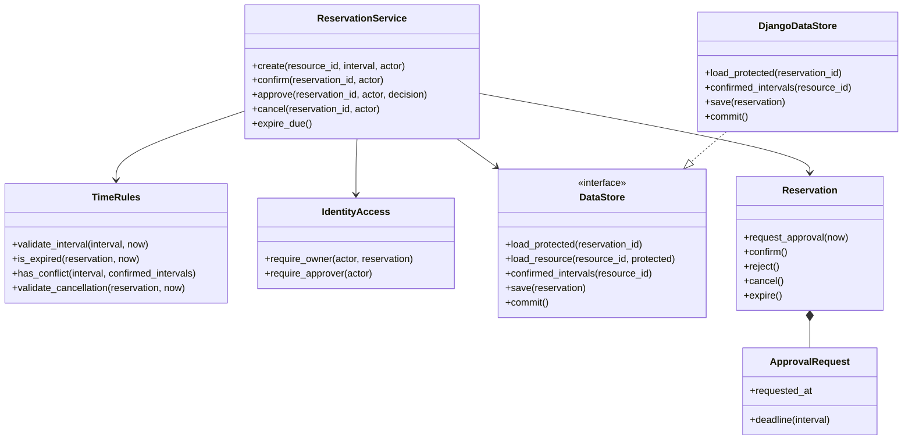
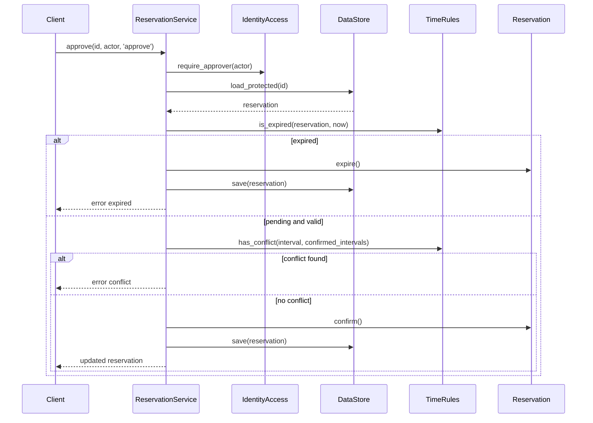

## C05 Detailed Design

Selected architecture unit:
Reservation lifecycle and approval gating

Related requirement(s):
- AD-01: zabránit dvojí rezervaci při souběžných požadavcích
- AD-02: zachovat konzistentní přechody stavu mezi confirm/approve/cancel
- AD-03: uchovat čekající schválení a expirační pravidla
- AD-04: vynutit identitu aktéra a oprávnění správce
- AD-05: používat společná časová pravidla pro čekací období a validaci intervalu

Related scenario(s):
- Uživatel potvrdí rezervaci pro zdroj, který vyžaduje schválení.
- Správce schválí nebo odmítne čekající žádost, zatímco jiná rezervace je vytvářena nebo potvrzována současně.
- Čekající schválení dosáhne 24hodinového nebo časového termínu startu a musí být expirováno bez konfliktu se stavem.

Relevant business rule(s):
- V jednom časovém intervalu může být potvrzena nejvýše jedna rezervace.
- Čekající schválení může zůstat ve stavu označeném jako pending až do rozhodnutí nebo expirace.
- Terminální stavy (CONFIRMED, REJECTED, CANCELLED, EXPIRED) se neotvírají znovu.
- Zdroje s požadavkem na schválení zůstávají při dotazování dostupnosti dostupné, dokud není žádost vyřízena.

Detailed responsibilities:

| Detailed responsibility | Why is it needed? |
| --- | --- |
| Ověřit zdroj, aktéra a interval před změnou | Zabraňuje neplatným nebo neoprávněným změnám ještě před uložením. |
| Rozhodnout, zda potvrzení vyžaduje schválení | Různé zdroje mají různé provozní a stavové postupy. |
| Zjistit konflikt proti již potvrzeným intervalům | Zajišťuje exkluzivitu a zabraňuje dvojí alokaci. |
| Vytvořit nebo aktualizovat deadline žádosti o schválení | Umožňuje časově omezený approval flow bez zůstatku starých rozhodnutí. |
| Převést rezervaci mezi stavy životního cyklu | Kóduje doménový stavový automat a dělá neplatné přechody explicitní. |
| Vyexpirovat zpožděné čekající žádosti | Zachovává konzistentní výsledek, když schválení chybí nebo vyprší čas. |
| Vynutit pravidla zrušení a vlastnictví | Zabraňuje rušení cizích rezervací nebo použití expirovaných žádostí. |

Design elements and ownership:

| Responsibility | Owner | State/data | Why here? |
| --- | --- | --- | --- |
| Stavový automat rezervace | entita `Reservation` v doméně | `status`, `approval_request`, `resource`, `interval` | Toto je klíčová doménová politika; přechody stavu nejsou záležitostí HTTP. |
| Časová pravidla a deadline schválení | `TimeRules` | aktuální serverový čas, limity intervalu, deadline schválení | Tato logika je sdílena mezi confirm, approve, cancel a expiraci. |
| Identita a oprávnění | `IdentityAccess` | `actor.id`, `actor.approval_permission`, vlastník rezervace | Autorizace patří na hranici mezi externím aktérem a doménou. |
| Ukládání zdrojů a intervalů | `DataStore` / `DjangoDataStore` | potvrzené rezervace, chráněné čtení, transakční kontext | Konflikty musí být ověřeny a uložené atomicky ve stejné databázové transakci. |
| Orchestrace operací rezervace | `ReservationService` | továrna na storage, sady pravidel a identit | Toto je vstupní bod pro create/confirm/approve/cancel/expire. |
| Dotaz na dostupnost | `AvailabilityQueries` | dostupnost zdroje a potvrzené intervaly | Čtecí dotaz je oddělený od mutační logiky. |

Key interface(s) / contract(s):

> `ReservationService.approve(reservation_id, actor, decision='approve') -> Reservation`

Kontrakt:

Preconditions:
- `actor` je autentizovaný;
- rezervace existuje a je ve stavu `PENDING_APPROVAL`;
- zdroj je stále vyhodnocen proti aktuálním potvrzeným intervalům;
- `decision` je buď `approve` nebo `reject`.

Postconditions:
- `approve` přepne rezervaci na `CONFIRMED`, pokud neexistuje konflikt;
- `reject` přepne rezervaci na `REJECTED`;
- výsledek je uložen ve stejné transakci jako kontrola konfliktu.

Failures:
- `conflict`, pokud rezervace není v čekajícím stavu nebo pokud vznikne nový konflikt;
- `expired`, pokud uplynul approval window a rezervace musí být expirována;
- `forbidden` nebo `not_found`, pokud je identita nebo zdroj neplatný.

Focused structural view:



Detailed sequence:



Important methods / operations:

Operace: `Reservation.request_approval(now)`
Odpovědnost: Přesunout DRAFT rezervaci do stavu `PENDING_APPROVAL` a zapsat deadline schválení.
Vstup: aktuální serverový čas.
Výstup: přechod stavu a vytvoření `ApprovalRequest`.
Preconditions: stav rezervace je `DRAFT`.
Postconditions: status se změní na `PENDING_APPROVAL`; `approval_request.requested_at` je nastaven.
Vedlejší efekty: žádné, kromě změny stavu rezervace.
Chování při chybě: vyvolá `ReservationError('conflict', ...)`, pokud stav není způsobilý.

Operace: `TimeRules.is_expired(reservation, now)`
Odpovědnost: Rozhodnout, zda čekající žádost překročila svůj platný deadline.
Vstup: instance rezervace a aktuální čas.
Výstup: `True`, pokud je pending a `now >= min(requested_at + 24h, interval.start)`, jinak `False`.
Preconditions: `reservation.approval_request` může chybět; v takovém případě se doménové pravidlo chová jako expirace.
Postconditions: žádná mutace.
Chování při chybě: žádné; vrátí boolean, který služba převádí na `expired` chybu.

Operace: `ReservationService.approve(reservation_id, actor, decision)`
Odpovědnost: Vyřešit čekající schválení se zachováním jednovítězného pravidla.
Vstup: ID rezervace, aktér a rozhodnutí.
Výstup: aktualizovaná rezervace.
Preconditions: aktér je správce; rezervace je pending; časové pravidlo ještě nevypršelo.
Postconditions: pro `approve` se rezervace potvrdí, pokud neexistuje konflikt; pro `reject` přejde do `REJECTED`.
Vedlejší efekty: trvalá změna v transakčním rozsahu.
Chování při chybě: vrací konflikty nebo `expired` bez ukládání terminálního stavu.

Algorithm / decision logic: (if relevant)

```text
if reservation is not PENDING_APPROVAL:
    raise conflict

if is_expired(reservation, now):
    reservation.expire()
    save(reservation)
    commit()
    raise expired

if decision == 'reject':
    reservation.reject()
elif decision == 'approve':
    if resource is unavailable or interval conflicts with confirmed reservations:
        raise conflict
    reservation.confirm()
else:
    raise invalid_input

save(reservation)
commit()
return reservation
```

Pravidlo deadlinu je explicitní:

```text
approval_deadline = min(requested_at + 24h, reservation.interval.start)
expired = pending and now >= approval_deadline
```

To zabraňuje tomu, aby zpožděná žádost pokračovala po vypršení SLA nebo po začátku rezervace.

DD decisions intentionally left to code:

Tato rozhodnutí jsou záměrně nízkoúrovňová a nepatří do architektury DD, protože jsou implementačně specifická:
- přesné Python výjimky a jejich textové hlášky;
- použití SQLite transakčních a lockových mechanismů v adapteru;
- jména privátních helperů typu `_decide_confirmation()` a `_transition()`, pokud je jejich obchodní význam jasný z kontraktu domény;
- framework boilerplate v Django request handling a JSON response.

Design intent je záměrně zachován na úrovni architektury a domény, zatímco zbylé mechanismy zůstávají lokální pro implementaci.
