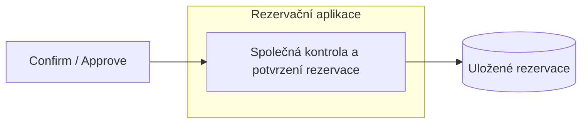
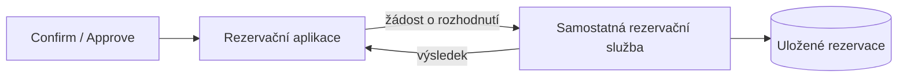

# Hlavní rozhodovací otázka

**Rozhodovací otázka:** Má potvrzování a schvalování rezervací řídit společná část rezervační aplikace, nebo samostatná služba?

**Proč to řešíme:** Dvě žádosti o stejné hřiště ve stejný čas mohou přijít
současně. Potvrzení uživatelem (Confirm) i schválení správcem (Approve)
mohou vytvořit potvrzenou rezervaci. Obě operace proto musí používat společné
rozhodování, které zajistí, že uspěje nejvýše jedna z kolidujících žádostí.

**Zdroj:** AD-01, BR-02, BR-06, REQ-04.

## Alternativa A — společná část aplikace

Confirm i Approve volají stejnou část aplikace. Ta zkontroluje, zda je
sportoviště volné, a uloží potvrzení. Mezi kontrolou a uložením nesmí jiný
požadavek potvrdit kolidující rezervaci. To musí platit i při souběžném běhu
více kopií aplikace.

## Alternativa B — samostatná služba

Aplikace pošle požadavek samostatně běžící službě. Ta zkontroluje kolize,
rozhodne a uloží změnu. Aplikace sama rezervace nemění; přes službu prochází
také vytvoření, zrušení a expirace. Stav rezervací tak má jednoho vlastníka.
I služba musí zajistit, aby současně nepotvrdila dvě kolidující žádosti.

## Porovnání podle driverů

Kritéria vycházejí z [driverů AD-01 až AD-05](architecture-drivers.md).
Tabulka popisuje důsledky návrhu, nikoliv již implementované změny.

| Driver / kritérium | Alternativa A — společná část aplikace | Alternativa B — samostatná služba |
| :--- | :--- | :--- |
| **AD-01: zabránění dvojí rezervaci** | Confirm i Approve musí používat společnou kontrolu a uložení chráněné proti souběhu. Lze navázat na stávající SQLite režim IMMEDIATE; ten ale blokuje i souběžné zápisy pro různá sportoviště. | Všechny požadavky na potvrzení směřují do služby. I ta potřebuje ochranu kontroly a uložení v databázi; samotný přesun do služby nezabrání dvojí rezervaci ani automaticky nezvýší počet paralelních zápisů. |
| **AD-02: změny stavu a nejasný výsledek při selhání** | Confirm, Approve a Cancel pracují se stejným stavem uvnitř aplikace. Pokud zrušení uspěje první, následné schválení musí být odmítnuto. Po ztracené odpovědi klientovi je nutné ověřit uložený stav. | Také Cancel musí projít službou, jinak by se stav měnil na dvou místech. Navíc může služba změnu uložit, ale aplikace nedostane odpověď. Je nutné zjistit výsledek a bezpečně rozpoznat opakovaný požadavek. |
| **AD-03: čekající žádosti, restart a provoz** | Čas žádosti zůstává v databázi aplikace. Po restartu se pokračuje z uložených údajů; plánované spouštění expirace se provozuje spolu s aplikací. | Čekající žádosti i expiraci spravuje služba. Je potřeba samostatně nasazovat a hlídat službu i spouštění expirace. Při nedostupné službě může aplikace běžet, ale rezervace nemůže měnit. |
| **AD-04: kontrola oprávnění** | Společná část může používat ověřenou identitu uživatele a zkontrolovat vlastnictví či oprávnění správce. API ani admin nesmějí tyto kontroly obejít. | Aplikace musí službě předat důvěryhodnou identitu aktéra. Služba musí ověřit volajícího a pravomoc uživatele; nesmí přijmout schválení jen podle neověřeného příznaku „jsem správce“ v požadavku. |
| **AD-05: stejné časové hranice** | Confirm, Approve, Cancel i expirace používají společná časová pravidla a rozhodný serverový čas. Hraniční příklady lze ověřit v rámci aplikace. | Konečné časové rozhodnutí musí udělat služba. Žádost odeslaná aplikací před deadline může dorazit až po něm a být odmítnuta; aplikace nesmí slibovat úspěch podle vlastních hodin. |

Obě varianty mohou splnit pravidla baseline. A má méně provozních prvků;
B umožňuje samostatné nasazení rozhodování, ale přidává komunikaci,
ověřování mezi aplikací a službou a další možnosti selhání.
Žádná varianta zatím není vybraná.

## Průchod scénářem — dvě současná schválení

**Scénář C02:** Dvě rezervace X a Y žádají stejné sportoviště ve stejném
budoucím intervalu. Sportoviště vyžaduje schválení.
**Komplikace:** Správci schválí obě žádosti současně, před jejich vypršením.
Sportoviště je dostupné a zatím nemá jinou potvrzenou rezervaci.

| Krok / událost | Alternativa A | Alternativa B |
| :--- | :--- | :--- |
| Vzniknou žádosti X a Y | Aplikace uloží dvě DRAFT. Jejich překryv při Create nevadí. | Aplikace předá vytvoření službě, která uloží dvě DRAFT a vrátí jejich ID. |
| Vlastníci spustí Confirm | Společná část ověří vlastníky, čas, dostupnost a kolize. Protože je potřeba schválení, uloží obě jako PENDING_APPROVAL s časem podání. | Stejné kontroly a změny provede služba. Aplikace předá její výsledky uživatelům. |
| Původní požadavky skončí | Čekající stav a čas podání zůstávají v databázi aplikace. Původní požadavky už nemusí běžet. | Údaje zůstávají v databázi služby. Aplikace nemusí držet otevřené spojení po celou dobu čekání. |
| Uživatel ověří dostupnost | Vrátí AVAILABLE: čekající žádosti sportoviště neblokují. | Služba poskytne stejný čtecí výsledek; aplikace ho vrátí uživateli. |
| Později přijdou dvě Approve současně | Obě vstoupí do společného rozhodování. Ověří se oprávnění správce a platnost čekající žádosti. | Aplikace předá obě rozhodnutí službě. Ta ověří oprávnění a deadline při svém rozhodování, nikoliv podle času odeslání z aplikace. |
| První rozhodnutí uspěje — například X | Aplikace pod ochranou proti souběhu ověří kolizi a uloží X jako CONFIRMED. Druhá operace nesmí mezitím potvrdit Y podle starého stavu. | Služba stejně chrání kontrolu a uložení X. Oddělený proces sám tuto ochranu nezajišťuje. |
| Druhé rozhodnutí se vyhodnotí pro Y | Musí vidět již potvrzenou X. Vrátí konflikt 409 a Y zůstane PENDING_APPROVAL. | Služba vrátí stejný konflikt a zachová Y. Aplikace výsledek předá správci; sama stav nepřepisuje. |
| Výsledný stav | Právě jedna CONFIRMED, druhá PENDING_APPROVAL. Dostupnost stejného intervalu je UNAVAILABLE. | Stejný stav; rozhodnutí i zápisy jsou ve službě, výsledky se navíc předávají mezi službou a aplikací. |

**Co průchod ukázal:** Obě varianty mohou zachovat BR-02, pokud druhé
rozhodnutí vychází z aktuálního stavu a kontrolu nelze oddělit od uložení.
Není určeno, zda vyhraje X nebo Y. U A je tato hranice uvnitř aplikace;
u B ji musí zajistit služba pro všechny své instance.

Jde o průchod návrhem. Souběh schválení v současné aplikaci ověřuje test
`test_conflicting_approvals_commit_only_one_allocation`; samostatná služba
varianty B zatím není implementovaná ani otestovaná.
