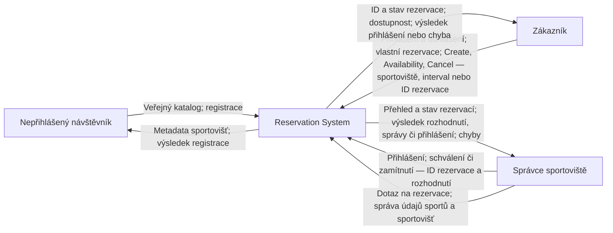

# G1 — Kontext systému

Zákazník a správce jsou dvě role; jeden člověk může mít obě.
Vazby zpět k aktérům jsou odpovědi na jejich požadavky, nikoliv automatické
notifikace. Diagram vychází z [projektového rámce](../requirements/overview.md)
a [baseline v0.2](../history/baseline-v0.2.md).

Přihlašování probíhá uvnitř systému. Externí poskytovatel identity ani
notifikační služba nejsou v současném rozsahu. Databáze, vnitřní části
aplikace a mechanismus expirace se v tomto pohledu nezobrazují.

Webový rozsah doplňují [REQ-07 až REQ-11](../requirements/README.md) a [návrh webového portálu](../design/web-portal.md). Veřejný katalog neobsahuje soukromé rezervace ani frontu správce.
