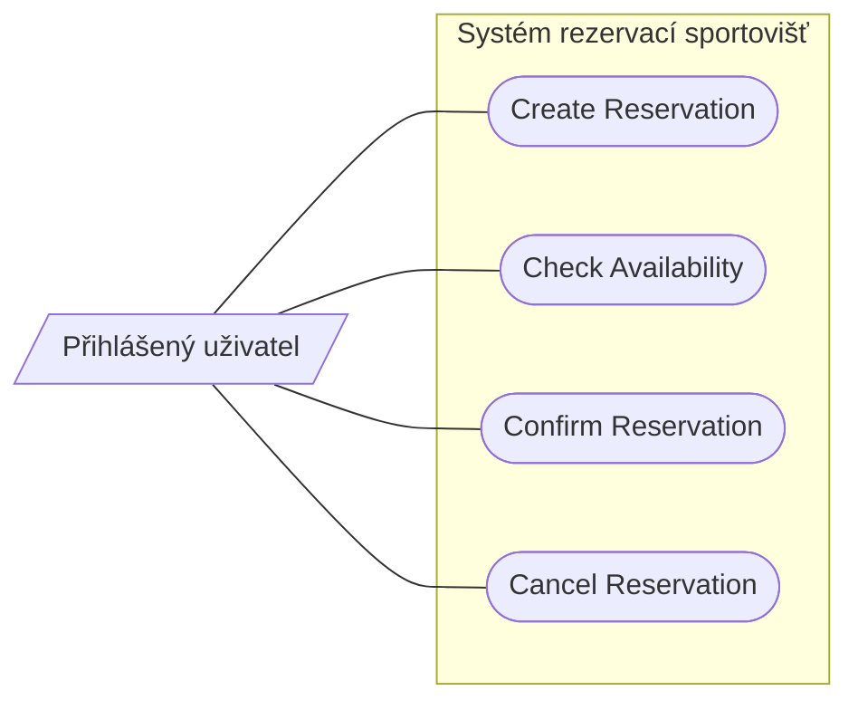
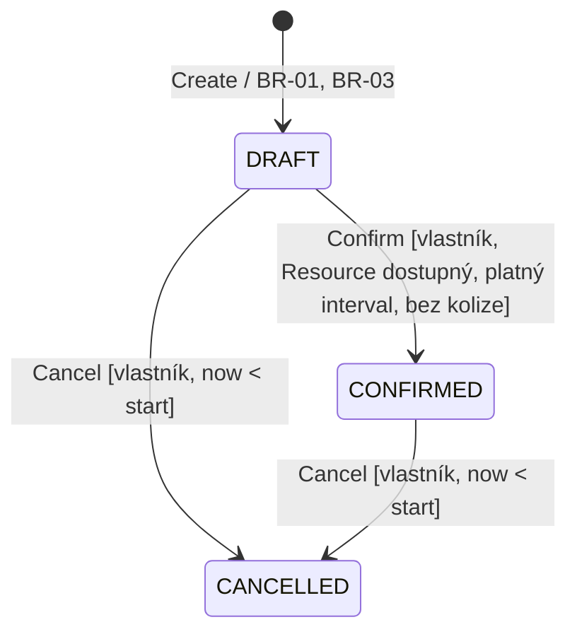
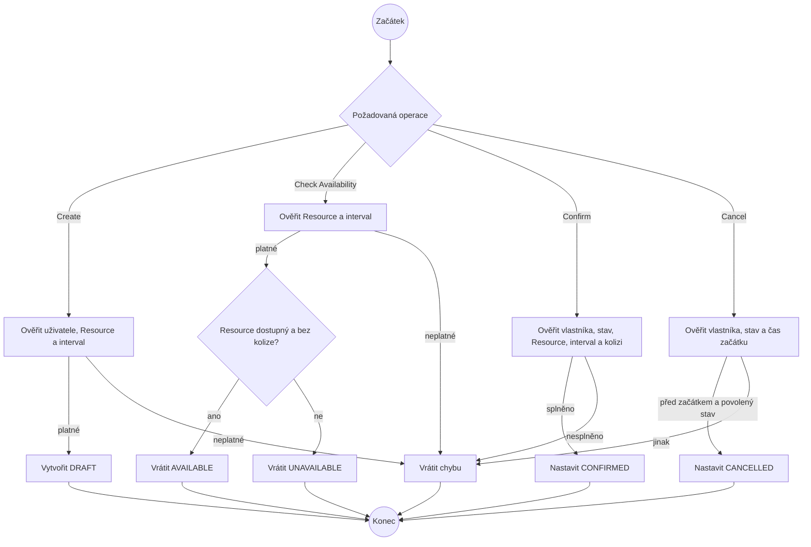

# Specification Baseline v0.1

**Stav: předchozí specifikace; nahrazena baseline v0.2. Týmové schválení v0.1 není doloženo.**

Tento dokument popisuje minimální systém pro rezervaci sportovišť. Slova
`Reservation`, `Resource` a názvy stavů jsou použity jednotně, aby se pravidla
dala porovnat s diagramy i s budoucí aplikací.

## Doménová pravidla

- **BR-01 — Časový interval:** Interval rezervace je polouzavřený
  `[start, end)`. Platí tedy `start < end`; rezervace končící přesně v okamžiku,
  kdy další začíná, se nepřekrývají. Časy jsou časové údaje včetně časového
  pásma.
- **BR-02 — Výhradní Resource:** Resource může mít v jednom okamžiku nejvýše
  jednu rezervaci ve stavu `CONFIRMED`. Překryv nastává, pokud
  `existing.start < requested.end` a `requested.start < existing.end`.
  Rezervace `DRAFT` a `CANCELLED` Resource neblokují.
- **BR-03 — Platný požadovaný čas:** Při vytvoření i potvrzení musí začátek
  rezervace být nyní nebo v budoucnu, nejvýše 30 dní od aktuálního času.
  Délka rezervace je kladná a nejvýše 2 hodiny. Hranice 30 dní a 2 hodin
  jsou povolené.
- **BR-04 — Dostupný Resource:** Resource s příznakem dostupnosti je možné
  potvrdit. Nedostupný Resource nelze potvrdit a kontrola jeho dostupnosti
  vrací `UNAVAILABLE`.
- **BR-05 — Zrušení:** Vlastník může zrušit svou rezervaci ve stavu `DRAFT`
  nebo `CONFIRMED` pouze před jejím začátkem. Zrušená rezervace zůstává
  v evidenci a její stav je `CANCELLED`. Opakované zrušení je odmítnuto.
- **BR-06 — Souběh:** Ani při současných pokusech o potvrzení nesmějí být
  potvrzeny dvě překrývající se rezervace stejného Resource. Při souběžném
  konfliktu uspěje nejvýše jedno potvrzení.

## OP-01 — Create Reservation

**Cíl / hodnota pro uživatele:** Uživatel podá žádost o rezervaci, aniž by
se tím Resource rovnou zablokoval.

**Spouštěcí událost:** Přihlášený uživatel odešle Resource a požadovaný
časový interval.

**Pozorovatelný požadavek:** Systém uloží požadavek jako `DRAFT` pouze
pro existující Resource a platný interval. Vlastníkem je přihlášený uživatel.

**Předpoklady:**
- Uživatel je přihlášen.
- Resource existuje.

**Stav po úspěšném provedení:** V evidenci je jedna nová rezervace ve stavu
`DRAFT`; systém vrací její identifikátor a stav. Žádný Resource není
alokován.

**Změna stavu:** `[initial] → DRAFT`.

**Odkaz na pravidla:** BR-01, BR-03.

**Hlavní úspěšný scénář:**
1. Uživatel odešle Resource a interval.
2. Systém ověří přihlášení, existenci Resource a časová pravidla.
3. Systém uloží rezervaci ve stavu `DRAFT`.
4. Systém vrátí identifikátor rezervace a její stav.

**Alternativní / chybové výsledky:**
- Uživatel není přihlášen → požadavek je odmítnut, rezervace nevznikne.
- Resource neexistuje → požadavek je odmítnut, rezervace nevznikne.
- `start >= end`, začátek je v minulosti nebo více než 30 dní dopředu,
  případně délka přesahuje 2 hodiny → požadavek je odmítnut, rezervace
  nevznikne.
- Kolize s jinou rezervací není důvodem odmítnutí vytvoření `DRAFT`;
  konflikt se řeší při potvrzení.

**Příklady ověření:**
- Existující Resource, začátek zítra 15:00, konec 16:30 → vznikne jedna
  `DRAFT`.
- Začátek i konec 15:00 → odmítnuto, žádná rezervace nevznikne.
- Interval delší než 2 hodiny → odmítnuto.
- Začátek přesně 30 dní od aktuálního času a délka 2 hodiny → přijato.
- Neznámý Resource → odmítnuto.

**Zdůvodnění / zdroj:** Create zaznamená záměr uživatele. `DRAFT` ještě
nealokuje Resource, takže kontrola kolize patří až k potvrzení.

## OP-02 — Check Availability

**Cíl / hodnota pro uživatele:** Uživatel zjistí, zda lze pro Resource
požadovaný interval potvrdit.

**Spouštěcí událost:** Uživatel požádá o kontrolu Resource a intervalu.

**Pozorovatelný požadavek:** Pro platný interval systém vrátí `AVAILABLE`,
pokud je Resource dostupný a nekoliduje s žádnou `CONFIRMED` rezervací;
jinak vrátí `UNAVAILABLE`. Kontrola nic nezapisuje a nic neblokuje.

**Předpoklady:**
- Resource existuje.
- Interval splňuje BR-01 a BR-03.

**Stav po úspěšném provedení:** Je vrácen výsledek `AVAILABLE` nebo
`UNAVAILABLE`; stav rezervací zůstává beze změny.

**Změna stavu:** Žádná.

**Odkaz na pravidla:** BR-01, BR-02, BR-03, BR-04.

**Hlavní úspěšný scénář:**
1. Uživatel zadá Resource a interval.
2. Systém ověří existenci Resource a platnost intervalu.
3. Systém zkontroluje dostupnost Resource a překryv s `CONFIRMED`
   rezervacemi stejného Resource.
4. Systém vrátí výsledek.

**Alternativní / chybové výsledky:**
- Neznámý Resource nebo neplatný interval → chyba; nejde o výsledek
  `AVAILABLE`.
- Resource je označen jako nedostupný nebo existuje překrývající se
  `CONFIRMED` rezervace → `UNAVAILABLE`.
- Překrývající se `DRAFT` nebo `CANCELLED` rezervace výsledek nemění.

**Příklady ověření:**
- Existuje `CONFIRMED` `[10:00, 11:00)`: dotaz `[09:00, 10:00)` →
  `AVAILABLE`.
- Stejná rezervace: dotaz `[10:30, 11:30)` → `UNAVAILABLE`.
- Stejná rezervace: dotaz `[11:00, 12:00)` → `AVAILABLE`.
- Pouze překrývající se `DRAFT` → `AVAILABLE`, pokud je Resource dostupný.
- Nulový interval → chyba.

**Zdůvodnění / zdroj:** Samostatná kontrola umožňuje zjistit aktuální stav,
ale sama o sobě čas neblokuje. Výsledek se může změnit před potvrzením.

## OP-03 — Confirm Reservation

**Cíl / hodnota pro uživatele:** Uživatel změní svou žádost na platnou
rezervaci, která blokuje Resource.

**Spouštěcí událost:** Vlastník požádá o potvrzení své rezervace.

**Pozorovatelný požadavek:** Systém potvrdí pouze rezervaci ve stavu `DRAFT`,
jejíž Resource je dostupný, interval stále splňuje BR-03 a nekoliduje
s potvrzenou rezervací stejného Resource. Při souběžných konfliktních
požadavcích uspěje nejvýše jeden.

**Předpoklady:**
- Rezervace existuje a patří přihlášenému uživateli.
- Rezervace má stav `DRAFT`.

**Stav po úspěšném provedení:** Rezervace má stav `CONFIRMED` a blokuje
Resource ve svém intervalu.

**Změna stavu:** `DRAFT → CONFIRMED`.

**Odkaz na pravidla:** BR-01, BR-02, BR-03, BR-04, BR-06.

**Hlavní úspěšný scénář:**
1. Vlastník požádá o potvrzení rezervace.
2. Systém ověří vlastnictví, stav `DRAFT`, dostupnost Resource, platný
   interval a nepřítomnost kolize.
3. Systém rezervaci potvrdí.
4. Systém vrátí stav `CONFIRMED`.

**Alternativní / chybové výsledky:**
- Rezervace neexistuje nebo nepatří uživateli → požadavek je odmítnut,
  stav se nezmění.
- Rezervace není ve stavu `DRAFT` → požadavek je odmítnut, stav se nezmění.
- Resource je nedostupný, interval již nesplňuje BR-03 nebo nastala kolize
  → požadavek je odmítnut a rezervace zůstane `DRAFT`.
- Při dvou souběžných kolidujících potvrzeních je potvrzena nejvýše jedna;
  ostatní zůstanou `DRAFT`.

**Příklady ověření:**
- Platná `DRAFT`, dostupný Resource a bez kolize → `CONFIRMED`.
- Kolidující `CONFIRMED` rezervace → odmítnuto, původní zůstává `DRAFT`.
- Nedostupný Resource → odmítnuto, rezervace zůstává `DRAFT`.
- Dvě souběžná potvrzení kolidujících `DRAFT` → nejvýše jedna `CONFIRMED`.

**Zdůvodnění / zdroj:** Potvrzení je jediný okamžik, kdy se Resource
skutečně alokuje. Samotná kontrola dostupnosti není příslibem rezervace.

## OP-04 — Cancel Reservation

**Cíl / hodnota pro uživatele:** Vlastník může zrušit svou rezervaci
a uvolnit Resource bez odstranění záznamu.

**Spouštěcí událost:** Vlastník požádá o zrušení rezervace.

**Pozorovatelný požadavek:** Před začátkem lze zrušit rezervaci ve stavu
`DRAFT` nebo `CONFIRMED`. Systém změní její stav na `CANCELLED` a zachová
záznam. Zrušená rezervace již Resource neblokuje.

**Předpoklady:**
- Rezervace existuje a patří přihlášenému uživateli.
- Stav rezervace je `DRAFT` nebo `CONFIRMED`.
- Aktuální čas je před začátkem rezervace.

**Stav po úspěšném provedení:** Rezervace zůstává v evidenci ve stavu
`CANCELLED`; případný uvolněný čas může být znovu rezervován.

**Změna stavu:** `DRAFT → CANCELLED` nebo `CONFIRMED → CANCELLED`.

**Odkaz na pravidla:** BR-02, BR-05.

**Hlavní úspěšný scénář:**
1. Vlastník požádá o zrušení rezervace.
2. Systém ověří vlastnictví, stav a to, že rezervace ještě nezačala.
3. Systém změní stav na `CANCELLED`, záznam nemaže.
4. Systém vrátí stav `CANCELLED`.

**Alternativní / chybové výsledky:**
- Rezervace neexistuje nebo nepatří uživateli → požadavek je odmítnut.
- Rezervace je již `CANCELLED` → požadavek je odmítnut, stav se nezmění.
- Rezervace již začala → požadavek je odmítnut, stav se nezmění.
- Jiný stav než `DRAFT` nebo `CONFIRMED` → požadavek je odmítnut,
  stav se nezmění.

**Příklady ověření:**
- `DRAFT` před začátkem → `CANCELLED`; záznam zůstane.
- `CONFIRMED` před začátkem → `CANCELLED`; čas je následně dostupný.
- `CONFIRMED` přesně v čase začátku → odmítnuto.
- Již `CANCELLED` → odmítnuto.

**Zdůvodnění / zdroj:** Zrušení je trvalá změna stavu, nikoli fyzické
smazání. Hranice „před začátkem“ je přesná: při `now >= start` už zrušit
nelze.

## Kontrola přijetí požadavků

Při revizi byly zkontrolovány význam pojmů a hranic, důvod požadavku,
pozorovatelné chování, vzájemná proveditelnost a konkrétní ověřovací
příklady. Časové hranice a stavy, které blokují Resource, jsou výslovně
uvedeny v BR-01 až BR-06. Souběh je požadavkem na výsledek potvrzení,
nepředepisuje konkrétní databázi ani způsob implementace. Nejistota kolem
plateb a schvalování byla odstraněna z baseline: platba ani samostatné
schválení správcem nejsou součástí minimálního procesu v0.1. Přihlášený
vlastník provádí všechny čtyři operace se svou rezervací.

## Diagram případů užití

Uživatel může zkontrolovat dostupnost a vytvářet, potvrzovat i rušit vlastní
rezervace. Externí platební nebo notifikační služba do v0.1 nepatří.

## Stavový diagram Reservation

Přechod na `CONFIRMED` splňuje BR-02, BR-04 a BR-06. `CANCELLED` je
konečný stav; záznam zůstává uložen. Kontrola dostupnosti stav nemění.

## Diagram aktivit

## Kontrola konzistence

- Create ukládá `DRAFT` a nealokuje Resource; Confirm teprve vytváří
  alokaci.
- Check Availability i Confirm považují za blokující pouze překryv
  s `CONFIRMED` rezervací stejného Resource.
- Intervaly jsou v celém dokumentu polouzavřené `[start, end)`; sousední
  intervaly se nepřekrývají.
- Cancel odpovídá pravidlu BR-05 i stavovému diagramu; `DRAFT` ani
  `CONFIRMED` se po začátku zrušit nedají.
- Diagram případů užití obsahuje právě čtyři popsané operace a jediného
  aktéra. Diagram aktivit pokrývá rozhodnutí i úspěšné a chybové větve.
- Souběh potvrzení je pozorovatelným požadavkem BR-06; konkrétní technické
  řešení není součástí specifikace.
- Platba, automatické rušení po jednom dni, důvod zrušení a otevírací doba
  nebyly v zadání určeny jako závazné požadavky, a proto nejsou v baseline
  vymyšleny.
