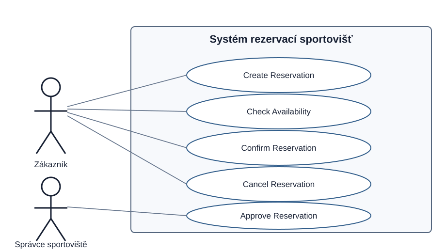
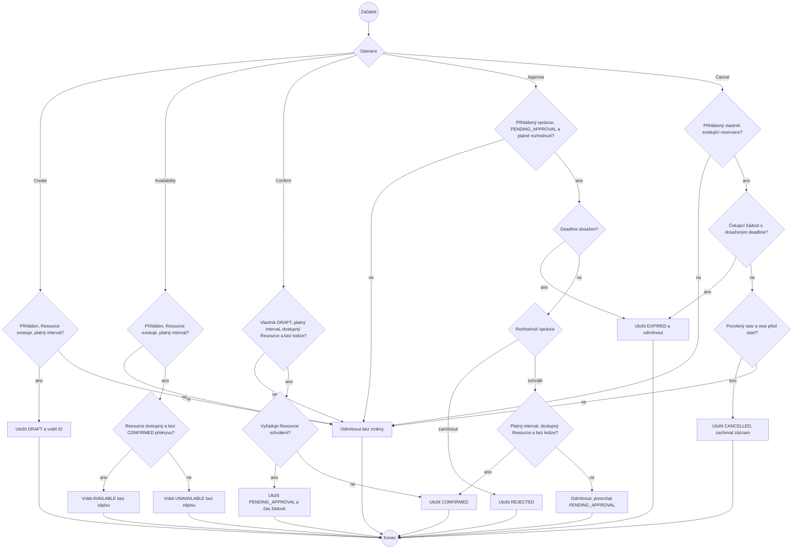

# Specification Baseline v0.2

**Změna:** C02 — schvalovací proces  
**Stav:** technicky revidováno 5. 10. 2026 a ověřeno testy;
formální týmové schválení není doloženo.

Tato verze navazuje na [baseline v0.1](./baseline-v0.1.md). Rezervace se
vytvoří jako `DRAFT`. U Resource, který vyžaduje schválení, uživatel požádá
o potvrzení, žádost čeká na správce a teprve schválení alokuje Resource.

## Dopad změny C02

**Změněná podmínka:** Některé Resource vyžadují rozhodnutí přihlášeného
správce před přechodem rezervace do `CONFIRMED`. Správce může žádost
schválit nebo zamítnout. Nevyřízená žádost vyprší po 24 hodinách; vyprší
také při začátku rezervace, pokud tento okamžik nastane dříve.

**Dotčené požadavky / části specifikace:**
- Resource dostává příznak `requires_approval`.
- `Confirm Reservation` vede buď přímo do `CONFIRMED`, nebo do
  `PENDING_APPROVAL`, podle Resource.
- Přibývá operace `Approve Reservation` a stavy `PENDING_APPROVAL`,
  `REJECTED` a `EXPIRED`.
- Dostupnost stále blokuje pouze `CONFIRMED`; žádost čekající na schválení
  čas neblokuje. Před rozhodnutím se kolize ověřuje znovu.
- `Cancel Reservation` nově dovoluje zrušit také `PENDING_APPROVAL`.
- Stavový diagram, use-case diagram, ověřovací příklady, API a evidence
  aplikace se aktualizují.

**Nedotčené požadavky / části + proč:**
- Create stále vytváří `DRAFT` a nealokuje Resource.
- Polouzavřený interval `[start, end)`, limit 30 dní dopředu, délka nejvýše
  2 hodiny a exkluzivita potvrzeného Resource zůstávají beze změny.
- Check Availability zůstává pouze čtecí operací.
- Rušení před začátkem rezervace stále zachovává záznam a přechází do
  `CANCELLED`.

**Nový aktér / operace:** Přihlášený správce (`is_staff`) a
`Approve Reservation`. Správce může rozhodovat pouze o žádosti, která čeká
na schválení.

**Změněná pravidla / význam stavů:** Podrobnosti jsou v BR-01 až BR-07
níže. `PENDING_APPROVAL` není alokace. `REJECTED`, `EXPIRED` a
`CANCELLED` jsou konečné stavy. Souběh se vyhodnotí jako sériové pořadí: zrušení před schválením
znemožní schválení; schválení před zrušením umožní obě operace.
Před začátkem a před expirací je v obou pořadích výsledkem `CANCELLED`.

**Změna diagramu případů užití:** Přibyl aktér Správce sportoviště a jeho
cíl `Approve Reservation`.

**Změna stavového diagramu:** Přibyly přechody čekající žádosti ke
schválení, zamítnutí nebo vypršení a rozšířila se možnost zrušení.

**Nové příklady ověření:** Zpožděné schválení před limitem, zamítnutí,
vypršení po 24 hodinách, dostupnost během čekání, kolize vzniklá během
čekání, zrušení čekající žádosti a nepovolené rozhodnutí běžným uživatelem.

**Architektonické drivery pro C03:** Je potřeba trvale uložit čas podání
žádosti, pravidelně spouštět expiraci a bezpečně synchronizovat schválení,
potvrzení a zrušení. Ukázka používá Django management command
`expire_reservations`; plánované spouštění a škálování souběhu
zůstávají tématem C03. Konkrétní scénáře a kritéria jsou v
[architektonických driverech](architecture-drivers.md).

## Doménová pravidla

- **BR-01 — Časový interval:** Interval je polouzavřený `[start, end)`;
  platí `start < end`. Dva intervaly, které se dotýkají pouze na hranici,
  se nepřekrývají.
- **BR-02 — Výhradní Resource:** Stejný Resource nesmí mít překrývající
  se rezervace `CONFIRMED`. K překryvu dochází, když
  `existing.start < requested.end` a `requested.start < existing.end`.
  `DRAFT`, `PENDING_APPROVAL`, `REJECTED`, `EXPIRED` a `CANCELLED`
  Resource neblokují.
- **BR-03 — Platný čas:** Začátek je nyní nebo v budoucnu, nejvýše 30 dní
  od aktuálního času. Délka je kladná a nejvýše 2 hodiny. Přesné hranice
  30 dní a 2 hodin jsou povolené.
- **BR-04 — Dostupný Resource:** Nedostupný Resource nelze potvrdit;
  Check Availability pro něj vrací `UNAVAILABLE`.
- **BR-05 — Zrušení:** Vlastník smí před začátkem zrušit rezervaci ve
  stavu `DRAFT`, `PENDING_APPROVAL` nebo `CONFIRMED`. Záznam se nemaže.
  Opakované zrušení ani zrušení po začátku není povoleno.
- **BR-06 — Souběh:** V jednom výsledném stavu nesmějí být dvě
  překrývající se rezervace stejného Resource `CONFIRMED`. Souběžné operace mají výsledek odpovídající sériovému pořadí.
  Pokud Confirm či Approve uspěje dříve než Cancel, vlastník stále může
  před začátkem zrušit `CONFIRMED`. Pokud Cancel uspěje dříve,
  potvrzení/schválení již není povolené.
- **BR-07 — Schvalování:** Resource s `requires_approval = false` se může
  potvrdit bez správce. U Resource s `requires_approval = true` přejde
  potvrzovací žádost do `PENDING_APPROVAL`. Žádost vyprší v okamžiku
  `approval_requested_at + 24 hodin`, nebo při začátku rezervace, podle
  toho, co nastane dříve. Po vypršení již nesmí být schválena, zamítnuta ani zrušena.
  Stav `EXPIRED` se uloží při pokusu o Approve/Cancel nebo při běhu
  expiračního příkazu. Mezi těmito událostmi může uložený stav zůstat
  `PENDING_APPROVAL`; nejde o platnou žádost a Resource stejně neblokuje.

## OP-01 — Create Reservation

**Cíl / hodnota pro uživatele:** Přihlášený uživatel podá žádost
o rezervaci bez alokování Resource.

**Spouštěcí událost:** Uživatel odešle Resource a časový interval.

**Pozorovatelný požadavek:** Pro existující Resource a platný interval
systém uloží rezervaci jako `DRAFT` a vrátí její ID a stav.

**Předpoklady:** Uživatel je přihlášen; Resource existuje.

**Stav po úspěšném provedení:** Jeden nový záznam `DRAFT`; Resource
zůstává volný pro další žádosti.

**Změna stavu:** `[initial] → DRAFT`.

**Odkaz na pravidla:** BR-01, BR-03.

**Hlavní úspěšný scénář:**
1. Uživatel odešle Resource a interval.
2. Systém ověří přihlášení, Resource a pravidla intervalu.
3. Systém uloží `DRAFT` a vrátí ID a stav.

**Alternativní / chybové výsledky:** Nepřihlášený uživatel, neznámý
Resource nebo neplatný interval → chyba, bez vytvoření rezervace.

**Příklady ověření:** Platný interval → jedna `DRAFT`; `start = end`,
více než 30 dní dopředu nebo délka přes 2 hodiny → odmítnuto.

**Zdůvodnění / zdroj:** Vytvoření zaznamenává záměr a samo nepřiděluje čas.

## OP-02 — Check Availability

**Cíl / hodnota pro uživatele:** Uživatel zjistí, zda je možné zvolený
interval potvrdit.

**Spouštěcí událost:** Uživatel odešle Resource a interval ke kontrole.

**Pozorovatelný požadavek:** Systém vrátí `AVAILABLE`, pokud je Resource
dostupný a v intervalu není jeho `CONFIRMED` rezervace; jinak vrátí
`UNAVAILABLE`. Žádost čekající na schválení dostupnost nemění.

**Předpoklady:** Uživatel je přihlášen; Resource existuje; interval splňuje BR-01 a BR-03.

**Stav po úspěšném provedení:** Vrácen výsledek bez změny záznamů.

**Změna stavu:** Žádná.

**Odkaz na pravidla:** BR-01 až BR-04, BR-07.

**Hlavní úspěšný scénář:**
1. Uživatel odešle Resource a interval.
2. Systém ověří vstup a zkontroluje dostupnost a překryv s potvrzenými
   rezervacemi.
3. Systém vrátí výsledek.

**Alternativní / chybové výsledky:** Nepřihlášený uživatel → odmítnuto.
Neplatný vstup nebo neznámý Resource
→ chyba; nedostupný Resource či potvrzený překryv → `UNAVAILABLE`.

**Příklady ověření:** Potvrzená `[10:00,11:00)` dává dotazům
`[09:00,10:00)` → `AVAILABLE`, `[10:30,11:30)` → `UNAVAILABLE` a
`[11:00,12:00)` → `AVAILABLE`. Samotný překryv `PENDING_APPROVAL` →
`AVAILABLE`.

**Zdůvodnění / zdroj:** Kontrola nic nerezervuje; výsledek se může před
potvrzením změnit.

## OP-03 — Confirm Reservation

**Cíl / hodnota pro uživatele:** Uživatel požádá o přijetí své `DRAFT`
rezervace. U Resource bez schválení vznikne alokace rovnou; jinak žádost
čeká na správce.

**Spouštěcí událost:** Vlastník odešle požadavek na potvrzení.

**Pozorovatelný požadavek:** Systém ověří vlastníka, stav, interval,
dostupnost a aktuální kolize. Poté při Resource bez požadavku na schválení
nastaví `CONFIRMED`; při požadavku na schválení nastaví
`PENDING_APPROVAL` a uloží čas žádosti.

**Předpoklady:** Rezervace existuje, patří uživateli a má stav `DRAFT`.

**Stav po úspěšném provedení:** `CONFIRMED` pro běžný Resource nebo
`PENDING_APPROVAL` pro Resource vyžadující schválení.

**Změna stavu:** `DRAFT → CONFIRMED` nebo `DRAFT → PENDING_APPROVAL`.

**Odkaz na pravidla:** BR-01 až BR-04, BR-06, BR-07.

**Hlavní úspěšný scénář:**
1. Vlastník požádá o potvrzení.
2. Systém ověří stav, čas, Resource a kolize.
3. Bez schvalování systém nastaví `CONFIRMED`; jinak nastaví
   `PENDING_APPROVAL` a zaznamená čas žádosti.

**Alternativní / chybové výsledky:** Neexistující/cizí rezervace,
nepovolený stav, neplatný interval, nedostupný Resource či existující
potvrzená kolize → chyba a stav se nezmění.

**Příklady ověření:** Bez schvalování a bez kolize → `CONFIRMED`;
Resource se schvalováním → `PENDING_APPROVAL`; potvrzená kolize →
odmítnuto a zůstává `DRAFT`.

**Zdůvodnění / zdroj:** Potvrzení je okamžik alokace; u vybraných
sportovišť musí před alokací rozhodnout správce.

## OP-04 — Cancel Reservation

**Cíl / hodnota pro uživatele:** Vlastník může před začátkem zrušit svou
žádost nebo rezervaci.

**Spouštěcí událost:** Vlastník odešle požadavek na zrušení.

**Pozorovatelný požadavek:** Rezervace ve stavu `DRAFT`,
`PENDING_APPROVAL` nebo `CONFIRMED` se před začátkem změní na
`CANCELLED`; záznam zůstává.

**Předpoklady:** Rezervace existuje, patří uživateli, má povolený stav
a ještě nezačala.

**Stav po úspěšném provedení:** Záznam `CANCELLED`; již neblokuje Resource.

**Změna stavu:** `DRAFT | PENDING_APPROVAL | CONFIRMED → CANCELLED`.

**Odkaz na pravidla:** BR-02, BR-05, BR-06.

**Hlavní úspěšný scénář:**
1. Vlastník požádá o zrušení.
2. Systém ověří vlastníka, stav a čas.
3. Systém nastaví `CANCELLED` bez smazání záznamu.

**Alternativní / chybové výsledky:** Cizí/neexistující rezervace,
nepovolený stav nebo začátek již nastal → odmítnuto.
Vypršelá čekající žádost → `EXPIRED` a odmítnuto (BR-07).
Souběh s Confirm/Approve odpovídá BR-06.

**Příklady ověření:** Čekající žádost před začátkem → `CANCELLED` a
zůstává uložená; rezervace přesně na hranici začátku → odmítnuto.

**Zdůvodnění / zdroj:** Rušení je změna stavu. U čekající žádosti je třeba
umožnit vlastníkovi stáhnout požadavek.

## OP-05 — Approve Reservation

**Cíl / hodnota pro uživatele:** Oprávněný správce rozhodne, zda čekající
žádost smí alokovat Resource.

**Spouštěcí událost:** Přihlášený správce odešle schválení nebo zamítnutí.

**Pozorovatelný požadavek:** Pouze uživatel s oprávněním správce může
rozhodnout o `PENDING_APPROVAL`. Schválení znovu ověří čas, dostupnost
a kolize; zamítnutí změní stav na `REJECTED`. Po limitu žádost přejde
do `EXPIRED` a nelze ji schválit.

**Předpoklady:** Rezervace existuje a je ve stavu `PENDING_APPROVAL`;
aktér je přihlášený správce.

**Stav po úspěšném provedení:** Schválení → `CONFIRMED`; zamítnutí →
`REJECTED`; vypršelá žádost → `EXPIRED`.

**Změna stavu:** `PENDING_APPROVAL → CONFIRMED | REJECTED | EXPIRED`.

**Odkaz na pravidla:** BR-01 až BR-04, BR-06, BR-07.

**Hlavní úspěšný scénář:**
1. Správce otevře čekající žádost a odešle rozhodnutí.
2. Systém ověří oprávnění a stav žádosti.
3. Při zamítnutí nastaví `REJECTED`; při schválení znovu ověří platnost
   intervalu, dostupnost a kolize.
4. Je-li kontrola úspěšná, systém nastaví `CONFIRMED`.

**Alternativní / chybové výsledky:** Běžný uživatel → zakázáno.
Žádost nečeká na rozhodnutí → odmítnuto. Po 24 hodinách nebo po začátku
rezervace → `EXPIRED`. Nedostupný Resource, neplatný čas či nová kolize
→ schválení odmítnuto a žádost zůstává `PENDING_APPROVAL`, aby ji správce
mohl zamítnout nebo zkusit znovu, pokud se podmínky změní.

**Příklady ověření:** Správce schválí platnou čekající žádost →
`CONFIRMED`; správce ji zamítne → `REJECTED`; běžný uživatel rozhodnout
nemůže; žádost starší 24 hodin → `EXPIRED`; kolize vzniklá během čekání
znemožní schválení.

**Zdůvodnění / zdroj:** C02 přidává lidské rozhodnutí před alokací.
Znovu se kontroluje dostupnost, protože `PENDING_APPROVAL` Resource
neblokuje.

## Kontrola přijetí požadavků

Pravidla BR-01 až BR-07 mají pozorovatelný výsledek a příklady v příslušných
operacích. Časové hranice jsou výslovné: interval je `[start,end)`,
rezervace začíná nejdříve nyní, maximum je 30 dní a 2 hodiny; schválení
vyprší při 24 hodinách nebo při začátku rezervace. Potřeba C02 je zachytit
zpožděné, zamítnuté a nevyřízené žádosti. Jedinou blokující rezervací je
`CONFIRMED`; proto se kolize znovu ověřuje při schválení. Oprávnění
schvalovat je v ukázce ověřitelné příznakem správce. REQ-01 až REQ-06 mají jednotlivé revizní záznamy v
[revizi požadavků](requirements-review.md). SQLite nyní zahajuje zápisové
transakce v režimu IMMEDIATE, takže rozhodující čtení a zápis jsou
serializované i nad různými rezervacemi. Pět testů souběhu prošly nad
souborovou databází. Přenos této záruky do jiné databáze a její škálování
jsou drivery C03; nejsou důvodem odložit invariant BR-02.

## Diagram případů užití

## Stavový diagram Reservation

`PENDING_APPROVAL` může skončit schválením, zamítnutím, vypršením nebo
zrušením vlastníkem. `CONFIRMED` dále umožňuje Cancel; konečné jsou pouze
`REJECTED`, `EXPIRED` a `CANCELLED`. Všechny stavy zachovávají záznam.
Podmínky přechodů odkazují na BR-01 až BR-07; diagram zkracuje popisky.

## Diagram aktivit

Aktivity jednotlivých operací; každá větev končí odpovědí uživateli.

Kontrola a změna stavu u Confirm, Approve a Cancel tvoří jednu
serializovanou operaci (BR-06). Neplatné oprávnění nikdy neprovádí změnu.
Expirační příkaz samostatně mění pouze čekající žádosti s dosaženým deadline
na EXPIRED; ostatní záznamy nemění a opakovaný běh je bezpečný.

## Kontrola konzistence a nedotčený rozsah

- Create zůstává `DRAFT`; příznak schválení na Resource ovlivní až
  potvrzovací žádost.
- Check Availability, Confirm i Approve považují za blokující pouze
  `CONFIRMED`. Approval při rozhodnutí kontroluje kolize znovu.
- Zrušení čekající žádosti odpovídá stavovému diagramu a uvolní žádost bez
  smazání.
- Schválení a zrušení jsou serializované podle BR-06. Schválení může
  předcházet úspěšnému zrušení; zrušení již neumožní pozdější schválení.
- Otevírací doba, platby a notifikace nejsou součástí operací v0.2.
  Notifikační služba uvedená v projektovém rámci nemá dosud popsané
  pozorovatelné chování, a proto není aktérem těchto use cases.
- Automatické plánované spouštění expirace není součástí lokální ukázky;
  pro skutečný provoz se musí `python manage.py expire_reservations`
  pravidelně plánovat. Interval plánovače je otevřený architektonický
  detail pro C03.

## Zbývající předpoklad / neznámá

- Doba schválení 24 hodin, neblokování Resource stavem
  `PENDING_APPROVAL` a oprávnění `is_staff` jsou převzaté volby stávajícího
  projektu. Doklad jejich schválení zadavatelem ani týmové schválení
  výsledné baseline není při této revizi k dispozici; tým je musí potvrdit.
- Při neúspěšném schválení kvůli kolizi žádost zůstává čekající až do
  zamítnutí, zrušení nebo vypršení.
- Notifikace uživatelům po změně stavu nejsou specifikovány.

## Dohledatelnost, čas a hranice ukázky

OP-01 = REQ-01; OP-02 = REQ-02; OP-03 = REQ-03 a REQ-04;
OP-04 = REQ-05; OP-05 = REQ-06. Zdroj času je serverové
`django.utils.timezone.now()` v UTC. Čas se odečte při rozhodování po
získání transakčních zámků, nikoli podle hodin klienta. Při `now = deadline`
již žádost vypršela. Hodnoty 24 hodin, 30 dní a 2 hodin jsou explicitní
volby projektu určené k týmovému potvrzení, nikoliv povinné hodnoty zadání.

Rezervační admin umožňuje pouze čtení záznamů; vytvoření, změna intervalu,
ruční změna stavu ani smazání nesmí obcházet popsané operace.
Správa Sport/Resource zůstává v adminu. Otevírací doba je uložené metadata,
její vynucování není přijato jako požadavek této baseline.
Záruky souběhu platí pro popsané API a expirační příkaz v lokální SQLite
ukázce. Přímé změny SQL/ORM mimo tyto vstupy nejsou business operace.
Po vyčerpání databázového timeoutu není v této ukázce definována uživatelská
politika retry; to je omezení pro C03, nikoli výjimka z exkluzivity.

**Týmové schválení v0.2: nedoloženo.** Doplnit skutečné datum, členy
a schválenou revizi. Zápis dopadu výše existuje, ale pořadí „analýza dopadu
před implementací“ nelze zpětně prohlásit za prokázané bez evidence týmu.
