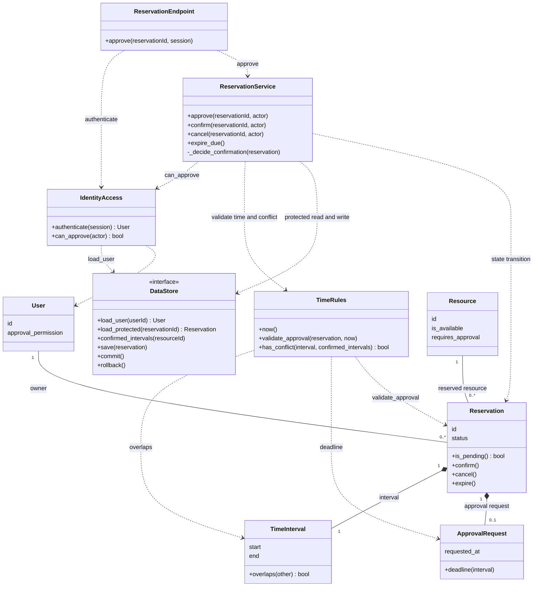

# H2 — Zaměřený návrhový třídní diagram

Deset tříd a rozhraní pro dvě současná schválení z [H1](design-sequence.md).
Názvy odpovídají návrhu kódu; mapování na části G2 je pod diagramem.

## Vlastníci operací z H1

| Lifeline z H1 / prvek G2 | Třída nebo rozhraní a operace |
| --- | --- |
| Vstupní rozhraní | `ReservationEndpoint.approve()` — přijme požadavek a vrátí HTTP výsledek. |
| Identita a oprávnění | `IdentityAccess.authenticate()` a `can_approve()` — ověří identitu a pravomoc správce. |
| Správa rezervací | `ReservationService.approve()` — řídí celé rozhodnutí; kontroluje `Reservation.is_pending()` a `Resource.is_available`. Confirm i Approve sdílejí `_decide_confirmation()` pro kontrolu Resource a kolizí. Při úspěchu zavolá `Reservation.confirm()`. |
| Časová pravidla | `TimeRules.now()`, `validate_approval()` a `has_conflict()` — používají `ApprovalRequest.deadline()` a `TimeInterval.overlaps()`. |
| Ukládání dat | `DataStore.load_protected()`, `confirmed_intervals()`, `save()`, `commit()` a `rollback()` — chrání a ukládají výsledek rozhodnutí. |

## Důležité smlouvy

- `load_protected()` získá ochranu **před načtením** rezervace a jejího
  Resource. `confirmed_intervals()` čte aktuální potvrzené intervaly v témže
  chráněném rozhodnutí. Ochrana platí i mezi procesy a trvá do `commit()`
  nebo `rollback()`; při výjimce se musí bezpečně ukončit. Každý požadavek
  má vlastní kontext ukládání: `commit()` jednoho požadavku nesmí dokončit
  práci druhého. Návrh nepoužívá sdílený globální „aktuální požadavek“.
- `ReservationService` vlastní rozhodnutí o BR-02. `Reservation.confirm()`
  mění stav jednoho objektu, ale sama neumí zabránit kolizi s jinou rezervací.
  Proto se nevolá přímo ze vstupního rozhraní ani mimo chráněné rozhodnutí.
  Confirm a Approve mají odlišné zdrojové stavy a oprávnění, ale společnou
  kontrolu alokace v `_decide_confirmation()`.
- Bez kolize se provede `confirm() → save() → commit()` a až potom se vrací
  úspěch. Při kolizi se použije `rollback()`, Y zůstane PENDING_APPROVAL
  a vstup vrátí 409. Chyba ukládání se nesmí vydávat za úspěšné potvrzení.
- Násobnosti zachovávají [doménový model](domain-model.md). ApprovalRequest
  nemá vlastní stav; výsledek schvalování je ve stavu Reservation.

Návrh je realizovaný uvnitř jedné aplikace podle ADR-01. `DataStore` je rozhraní
pro ukládání, nikoliv nová služba nebo databáze. Konkrétní databázová
implementace ani části nepoužité v H1 se zde nerozkreslují.

## Mapování na realizovaný kód

| Prvek návrhu | Soubor |
| --- | --- |
| ReservationEndpoint | `reservations/api.py`; `views.py` pouze předává HTTP volání |
| IdentityAccess | `reservations/identity.py` |
| ReservationService a Dotazy na dostupnost | `reservations/services.py` |
| TimeRules | `reservations/rules.py` |
| DataStore a konkrétní DjangoDataStore | `reservations/persistence.py` |
| Doménové entity a hodnoty | `reservations/domain.py` |

`wiring.py` propojuje konkrétní implementace při spuštění. ORM modely
zůstávají schématem pro uložení a nejsou totožné s doménovými objekty.
Diagram ukazuje veřejné role a vybrané operace, ne všechny parametry
interních pomocných metod.
