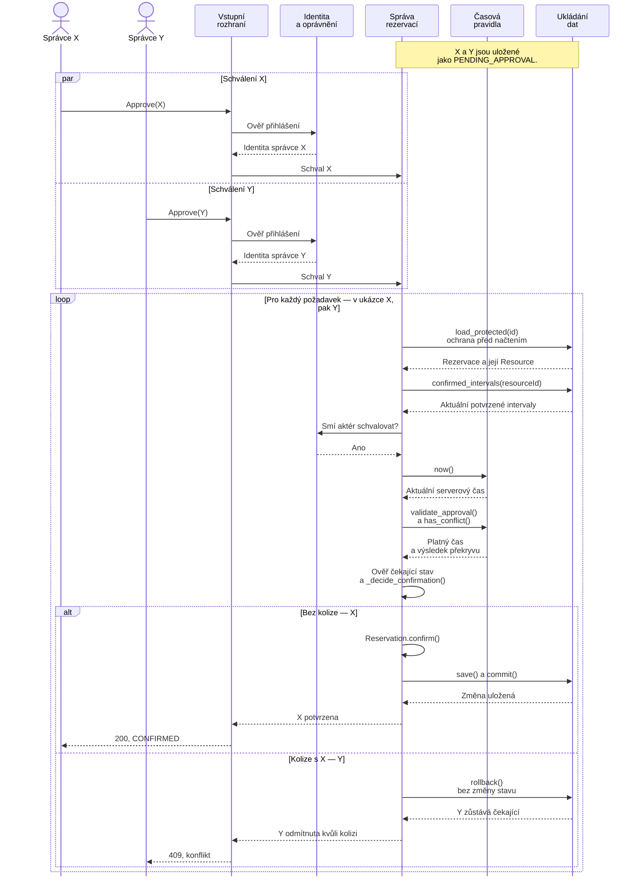

# H1 — Návrhový sekvenční diagram

Používáme [stejný scénář](architecture-decision.md#průchod-scénářem--dvě-současná-schválení):
dvě žádosti X a Y o stejné sportoviště a interval. Po Create a Confirm
jsou obě PENDING_APPROVAL; původní požadavky už skončily.
Později je dva oprávnění správci schválí současně, před deadline.
Sportoviště je dostupné a nemá jinou potvrzenou rezervaci.

Diagram realizuje variantu A z ADR-01 pomocí prvků [G2](static-architecture.md).

**Rozhoduje Správa rezervací.** Ukládání dat chrání její kontrolu a zápis
před jiným potvrzením. Y se načítá až po dokončení změny X, takže nesmí
rozhodovat podle starého stavu „volno“. Vítězem může být i Y; pořadí X → Y
je pouze příklad. Při více instancích aplikace musí ochrana platit také
mezi nimi.

Všechny vnitřní lifelines i jejich volání odpovídají G2. Správci jsou dvě
instance role z kontextu G1. Dotazy na dostupnost nejsou pro rozhodnutí
potřeba: předchozí AVAILABLE by potvrzení nezaručovalo.
Jde o návrh cílové spolupráce částí, nikoliv nový diagram současných view funkcí.

Načtení rezervace a načtení potvrzených intervalů jsou dvě operace stejného
chráněného kontextu. Čas se odečítá až po získání ochrany. Změnu objektu
`Reservation.confirm()` vyvolá Správa rezervací; Ukládání dat pouze uloží
výsledek. `_decide_confirmation()` je společná kontrola dostupného Resource
a kolize pro Confirm i Approve, jak požaduje ADR-01.
