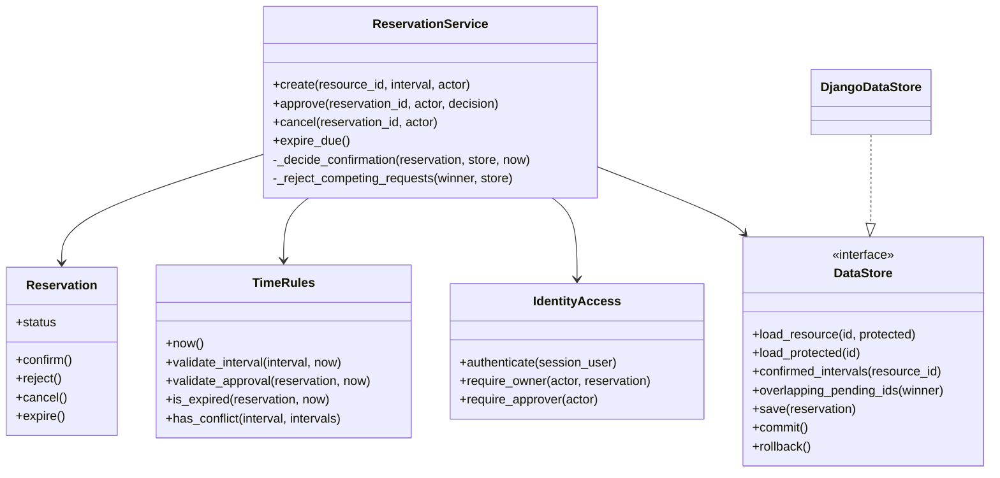

# H2 — Zaměřený návrhový třídní diagram

## Vlastníci operací z H1

| Část | Odpovědnost |
| --- | --- |
| Vstupní rozhraní | Validuje transportní vstupy a identifikuje aktéra |
| ReservationService | Volí počáteční stav, kontroluje dostupnost a kolize, řídí schválení a zamítnutí konkurentů |
| Reservation | Vynucuje povolené přechody jednoho objektu |
| TimeRules | Časová pravidla, polouzavřené intervaly a expirace při začátku |
| DataStore / DjangoDataStore | Chráněné čtení, výběr konkurentů a transakční uložení |

## Důležité smlouvy

Create i Approve mají vlastní kontext ukládání a společnou kontrolu `_decide_confirmation()`. Při vzniku `CONFIRMED` následuje `_reject_competing_requests()` před `commit()`. Výběr konkurentů používá stejné sportoviště, stav `PENDING_APPROVAL` a polouzavřený překryv. Vítěz je z výběru vyloučen.

`Reservation.confirm()` lze volat pouze na `PENDING_APPROVAL`. Automaticky potvrzená rezervace vzniká rovnou v cílovém stavu. Veřejná metoda `ReservationService.confirm()` ani odpovídající HTTP operace neexistují.

## Mapování na realizovaný kód

[Generované vazby na konkrétní symboly a testy](../verification/coverage.md) · [Sekvence](approval-sequence.md) · [Doménový model](domain-model.md)
