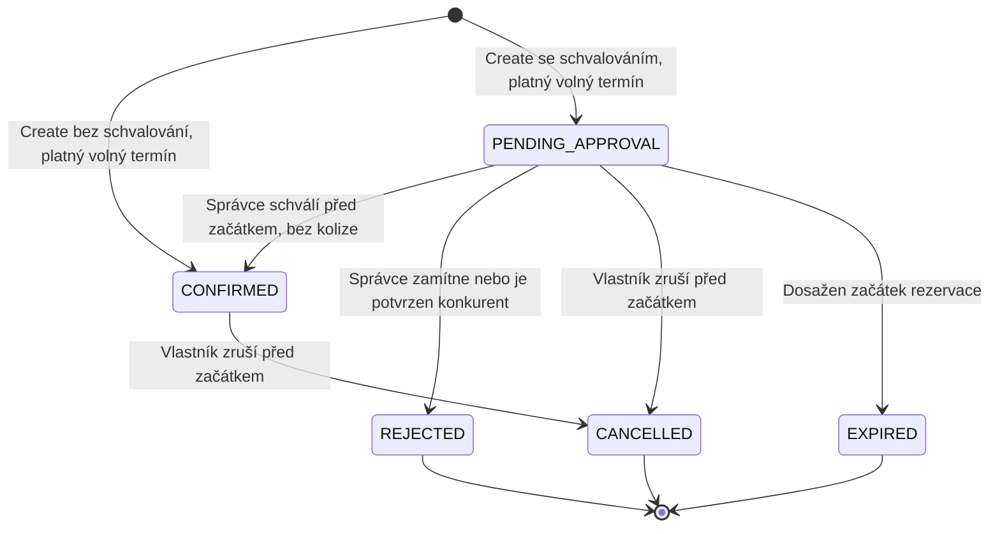

# G3 — Vlastnictví přechodů ve statechartu

Aktuální životní cyklus má pět stavů. `DRAFT` a samostatná operace Confirm byly zrušeny rozhodnutím uživatele 7. 11. 2026. Historický [statechart C02](../history/baseline-v0.2.md#stavový-diagram-reservation) zachovává tehdejší chování.

| Přechod | Owner rozhodnutí | Vyvolání |
| --- | --- | --- |
| Vznik `CONFIRMED` | Správa rezervací | Create pro sportoviště bez schvalování; validace a kontrola kolize |
| Vznik `PENDING_APPROVAL` | Správa rezervací | Create pro sportoviště se schvalováním; validace a kontrola kolize |
| `PENDING_APPROVAL → CONFIRMED` | Správa rezervací | Approve oprávněného správce |
| `PENDING_APPROVAL → REJECTED` | Správa rezervací | Zamítnutí správcem nebo potvrzení překrývajícího se konkurenta stejného sportoviště |
| `PENDING_APPROVAL → CANCELLED` | Správa rezervací | Cancel vlastníka před začátkem |
| `PENDING_APPROVAL → EXPIRED` | Správa rezervací | Approve, Cancel nebo expirační příkaz při `now >= starts_at` |
| `CONFIRMED → CANCELLED` | Správa rezervací | Cancel vlastníka před začátkem |

Při každém vzniku `CONFIRMED` služba ve stejné transakci zamítne všechny překrývající se `PENDING_APPROVAL` stejného sportoviště. Zrušení potvrzené rezervace zamítnuté žádosti neobnovuje. Sousední intervaly a jiná sportoviště nejsou dotčeny.

Check Availability stav nemění. Expirace při začátku je business pravidlo; databázový stav se aktualizuje při příslušné operaci nebo expiračním příkazu. Automatický plánovač zatím není nastaven.

[Vazby na implementaci a testy](../verification/coverage.md) · [Business pravidla](../requirements/business-rules.md)
