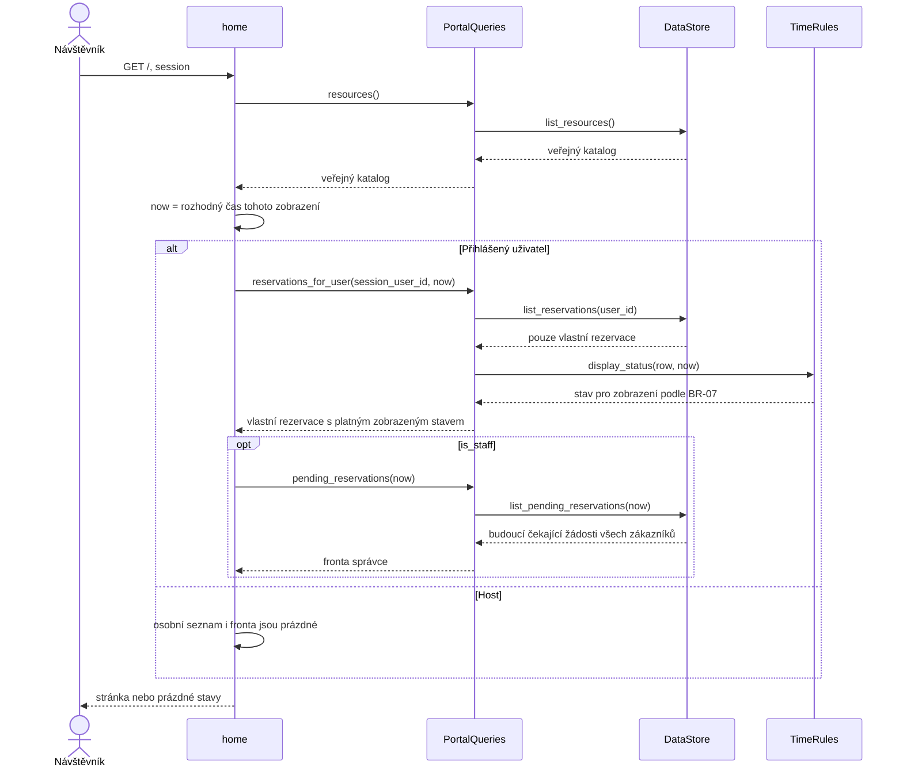

# Návrh webového portálu — REQ-07 až REQ-11

## Návrhový záměr

Veřejný katalog, uživatelské účty a přehledy doplňují rezervační proces. Čtení je bez zápisu rezervací a bez stavových přechodů. Identita a role pocházejí z ověřené Django relace; klient si nevolí vlastníka osobního seznamu ani roli správce.

## Odpovědnosti a kontrakty

| Požadavek | Vstupní owner | Realizace / kontrakt | Chyba nebo hranice |
| --- | --- | --- | --- |
| REQ-07 | `home` | `PortalQueries.resources → DataStore.list_resources` vrátí katalog včetně nedostupných položek | Prázdný seznam vykreslí zprávu, nepřihlášený přístup je povolen |
| REQ-08 | `register`, `RegistrationForm` | Validace přes Django UserCreationForm; po uložení běžného účtu následuje login | Chybné vstupy nevytvářejí účet; podstrčená oprávnění nejsou poli formuláře |
| REQ-09 | `PortalLoginView`, `PortalLogoutView` | Django LoginView a LogoutView používají ověřování účtu a relaci | Neaktivní účet se nepřihlásí; odhlášení mění stav jen přes POST s CSRF |
| REQ-10 | `home` | `reservations_for_user(user_id, now) → list_reservations(user_id)`; user_id vždy ze session | Osobní seznam nesmí přejít do globální fronty, ani pro správce |
| REQ-11 | `home` | Jen staff volá `pending_reservations(now) → list_pending_reservations(now)` | Pouze PENDING_APPROVAL a `starts_at > now`; žádost přesně na začátku není akční |

Kontext osobních rezervací a kontext fronty jsou oddělené. Nepřihlášený návštěvník dostane oba prázdné; běžný zákazník dostane pouze své rezervace. Správce má vlastní osobní přehled a oddělenou frontu všech sportovišť.

Význam času a zobrazeného stavu vlastní TimeRules, které používá i PortalQueries. Datový adaptér vrací uložené stavy. Konkrétní ORM zná pouze DjangoDataStore. Dotazy pro vlastní rezervace vyžadují explicitní user_id; samostatný dotaz fronty se nevolí vynecháním uživatele. U obou seznamů je pořadí `-starts_at, -pk`.

## Hlavní čtecí scénář a alternativy

## Časové hranice a vedlejší účinky

Home pořídí jeden časový snapshot pro osobní seznam, správní frontu a tlačítka v šabloně. Uložené `PENDING_APPROVAL` s `starts_at <= now` se v osobním seznamu přes `TimeRules.display_status` prezentuje jako `EXPIRED`, ale databáze se při GET nepřepisuje. Jde o projekci platnosti podle BR-07; skutečnou expiraci zapisuje společná rezervační služba. Fronta takový záznam vůbec nenabízí. Žádost starší 24 hodin s budoucím začátkem zůstává v seznamu.

Při následné změně se oprávnění, čas, kolize a stav znovu ověří podle REQ-05/06; seznam není oprávněním k provedení změny ani garancí výsledku.

## Odvození ověření

| Rozhodnutí návrhu | Pozorovatelný očekávaný výsledek |
| --- | --- |
| Veřejný katalog je nezávislý na autentizaci | Host uvidí metadata a nedostupné položky; prázdný katalog nevyvolá chybu |
| Registrace přijímá jen údaje běžného účtu | Platný účet je přihlášen; chybné vstupy nic nevytvoří; nelze si podstrčit staff roli |
| Identita vychází z aktivního účtu | Chybné heslo i neaktivní účet selžou; logout přes GET ani bez CSRF relaci neruší |
| Vlastník osobního seznamu je povinný | Zákazník ani správce v osobním seznamu neuvidí cizí rezervace |
| Fronta je samostatný staff dotaz s časovou hranicí | Host a zákazník nedostanou frontu; na hranici startu se žádost nezobrazí ke schválení |
| Čtení je bez stavových změn | Prošlá žádost se zobrazí správně, ale stav v DB zůstane nezměněný |

[Generované prokliky na konkrétní implementaci a testy](../verification/coverage.md#req-07) · [Vztah k zadáním a ověření](../verification/portal-requirements.md)

## Výběr času rezervace

[REQ-12 a návrh hodinového rozvrhu](hourly-schedule.md) doplňují ruční zadání. Čtecí dotaz `PortalQueries.weekly_schedule` používá stejné TimeRules a DataStore; vytvoření nadále řídí společná rezervační služba.
