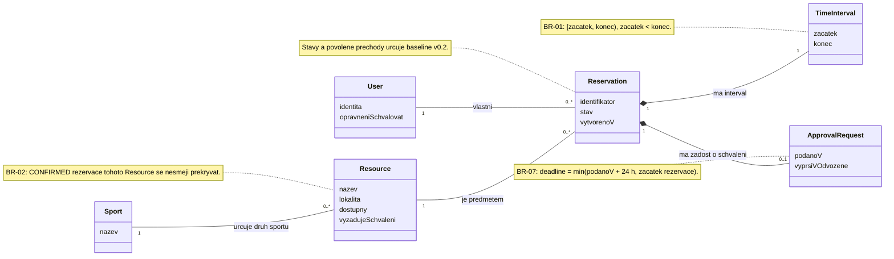

# Doménový třídní model — C03

Model vychází z existujících pojmů `User`, `Sport`, `Resource` a
`Reservation` a z [baseline v0.2](baseline-v0.2.md). Pro drivery časových
hranic a dlouhotrvajícího schvalování zpřesňuje `TimeInterval` a
`ApprovalRequest`. Celkem obsahuje šest doménových pojmů.

## Pojmy a business význam vztahů

| Pojem | Význam |
| --- | --- |
| `User` | Uživatel, který může vlastnit rezervace; schvalovací oprávnění umožňuje rozhodovat o čekajících žádostech. Zákazník a správce jsou role, které se mohou u jednoho uživatele kombinovat. |
| `Sport` | Druh sportovní aktivity. Jeden Sport může mít více sportovišť; každé Resource je v současném modelu přiřazené právě jednomu Sport. |
| `Resource` | Exkluzivně rezervovatelné sportoviště. Může mít libovolný počet rezervací, ale jejich potvrzené intervaly nesmějí kolidovat. |
| `Reservation` | Žádost nebo přijatá rezervace právě jednoho vlastníka a právě jednoho Resource. Její stav určuje, zda sportoviště alokuje. |
| `TimeInterval` | Právě jeden časový interval rezervace. Je součástí rezervace a nemá samostatnou identitu ani životní cyklus. |
| `ApprovalRequest` | Volitelná žádost o schválení patřící právě jedné rezervaci. Vzniká při Confirm vyžadujícím schválení; zahrnuje čas podání a odvozený deadline. Nemá samostatný stav: výsledek schvalování vyjadřuje stav Reservation. |

Násobnost `0..1` u ApprovalRequest znamená, že rezervace bez podané
schvalovací žádosti tento pojem neobsahuje. Opakované podávání po zamítnutí,
zrušení nebo expiraci současná baseline nepovoluje. Po rozhodnutí či
zrušení se záznam rezervace a čas podání zachovávají. Kompozice vyjadřuje
příslušnost hodnot k rezervaci, nikoliv požadavek na jejich smazání.

## Omezení a vazba na drivery

- **AD-01 / BR-02, BR-06:** Pro dvě různé `CONFIRMED` rezervace stejného
  Resource musí platit, že se jejich TimeInterval nepřekrývají. Jde o
  invariant vztahu Resource–Reservation, který platí také při souběhu.
  DRAFT ani PENDING_APPROVAL sportoviště neblokují.
- **AD-02 / BR-05 až BR-07:** Stav patří Reservation; všechny změny musí
  respektovat její povolený životní cyklus. CANCELLED, REJECTED a EXPIRED
  jsou konečné stavy.
- **AD-03 / BR-07:** ApprovalRequest a čas podání musí přežít konec
  původního požadavku i restart. Při dosaženém deadline už nelze žádost
  schválit, zamítnout ani zrušit; přechází do EXPIRED podle pravidel baseline.
- **AD-04 / OP-03 až OP-05:** Confirm a Cancel smí vyvolat pouze vlastník;
  Approve pouze uživatel se schvalovacím oprávněním. Model nezavádí
  přiděleného schvalovatele: taková vazba není v požadavcích stanovena.
- **AD-05 / BR-01, BR-03, BR-05, BR-07:** Časy označují skutečné okamžiky.
  TimeInterval používá `[start, end)`; další časové limity a hranice se
  přebírají z baseline a neodvozují se samostatně pro každou operaci.

## Vztah ke stávající aplikaci

TimeInterval zpřesňuje již existující začátek a konec rezervace;
ApprovalRequest zpřesňuje již existující čas žádosti o schválení a jeho
význam. Nezavádí se nový požadavek na samostatné tabulky, zaznamenávání
identity rozhodujícího správce ani další stav schvalování. Tento krok
upravuje doménový pohled; způsob reprezentace pojmů v kódu se rozhodne
při návrhu architektury.
