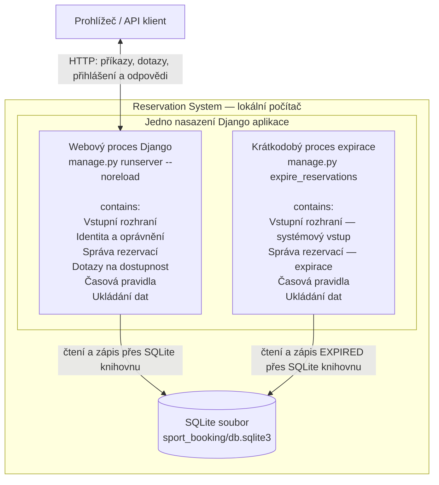

# G4 — Runtime a deployment mapping

Máme **jednu Django aplikaci**, nikoliv samostatnou rezervační službu.
Web i expirační příkaz používají stejný kód a stejnou lokální databázi.
Procesy a databáze níže existují. Logické části G2 jsou nyní oddělené
v kódu a expirační příkaz používá společnou Správu rezervací.



SQLite běží jako knihovna uvnitř obou procesů; databázový soubor není další
serverový proces. Přístup ke společnému souboru chrání databázové zámky.

## Mapování prvků z G2

| Logický prvek | Webový proces | Proces expirace |
| --- | --- | --- |
| Vstupní rozhraní | HTTP API a admin | Vstup management commandu |
| Identita a oprávnění | Přihlášení, vlastnictví a oprávnění správce | Nepoužívá uživatelské přihlášení; spouští ho oprávněný provozovatel |
| Správa rezervací | Create, Confirm, Approve, Cancel; kontrola expirace při Approve/Cancel | Přechod čekajících žádostí do EXPIRED |
| Dotazy na dostupnost | Check Availability | Nepoužívá se |
| Časová pravidla | Intervaly, kolize, začátek a deadline | Deadline čekajících žádostí |
| Ukládání dat | Uložení a načtení rezervačních a přihlašovacích údajů | Načtení čekajících žádostí a uložení expirace |

Správa rezervací má stejného logického vlastníka v obou procesech:
expirační příkaz není další služba s vlastními pravidly nebo databází.
Používá společná pravidla přechodů a času prostřednictvím ReservationService.

## Spuštění a hranice

Z kořene projektu po přípravě databáze:

```sh
.venv/bin/python sport_booking/manage.py runserver --noreload
```

Expiraci lze spustit v jiném terminálu; proces po dokončení skončí:

```sh
.venv/bin/python sport_booking/manage.py expire_reservations
```

`--noreload` vypíná pomocný proces automatického restartování vývojového
serveru, aby ukázka odpovídala jednomu webovému procesu v diagramu.
Web a expirace si neposílají zprávy; spolupracují přes stejný databázový
soubor. Při souběhu zápisů může jeden proces čekat na druhý.
Každá operace má vlastní databázový kontext; ochrana společného souboru
musí zabránit kolizi i mezi webovým a expiračním procesem.

Externí IdP ani notifikační služba nejsou zapojené. Automatický plánovač
expirace zatím není nakonfigurovaný; v diagramu proto není zobrazený jako
existující runtime systém. Ani čekání na schválení nevyžaduje otevřený
požadavek: stav a čas podání přežívají v SQLite souboru.
