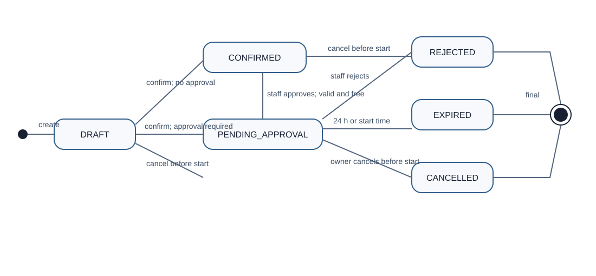

# G3 — Vlastnictví přechodů ve statechartu

Používáme stejný [statechart z C02](baseline-v0.2.md#stavový-diagram-reservation).
Stavy ani povolené přechody neměníme; doplňujeme jejich vlastníka podle
[G2](static-architecture.md).

| Přechod | Owner rozhodnutí | Kdo může transition pouze vyžádat |
| :--- | :--- | :--- |
| `[initial] → DRAFT` | Správa rezervací | Přihlášený zákazník přes Vstupní rozhraní: Create. |
| `DRAFT → PENDING_APPROVAL` | Správa rezervací | Vlastník přes Vstupní rozhraní: Confirm pro sportoviště vyžadující schválení. |
| `DRAFT → CONFIRMED` | Správa rezervací | Vlastník přes Vstupní rozhraní: Confirm pro sportoviště bez schvalování. |
| `PENDING_APPROVAL → CONFIRMED` | Správa rezervací | Oprávněný správce přes Vstupní rozhraní: Approve se schválením. |
| `PENDING_APPROVAL → REJECTED` | Správa rezervací | Oprávněný správce přes Vstupní rozhraní: Approve se zamítnutím. |
| `PENDING_APPROVAL → EXPIRED` | Správa rezervací | Plánované spouštění přes systémový vstup Vstupního rozhraní. Kontrola se vyvolá také při Approve nebo Cancel čekající žádosti. |
| `DRAFT → CANCELLED` | Správa rezervací | Vlastník přes Vstupní rozhraní: Cancel před začátkem. |
| `PENDING_APPROVAL → CANCELLED` | Správa rezervací | Vlastník přes Vstupní rozhraní: Cancel před začátkem a před vypršením žádosti. |
| `CONFIRMED → CANCELLED` | Správa rezervací | Vlastník přes Vstupní rozhraní: Cancel před začátkem. |

**Vyžádat neznamená povolit.** Správa rezervací ověří aktuální stav,
oprávnění, čas a při potvrzení také dostupnost a kolize. Používá přitom
Identitu a oprávnění, Časová pravidla a Ukládání dat; konečné rozhodnutí
o přechodu zůstává u Správy rezervací.

U EXPIRED zákazník ani správce nevolí výsledný stav: při dosaženém deadline
ho určí Správa rezervací a požadované schválení, zamítnutí či zrušení odmítne.
Plánované spouštění pouze vyvolá kontrolu, samo stav nemění.
Check Availability žádný přechod nevyvolává. Konečné stavy REJECTED,
EXPIRED a CANCELLED nelze znovu otevřít.
