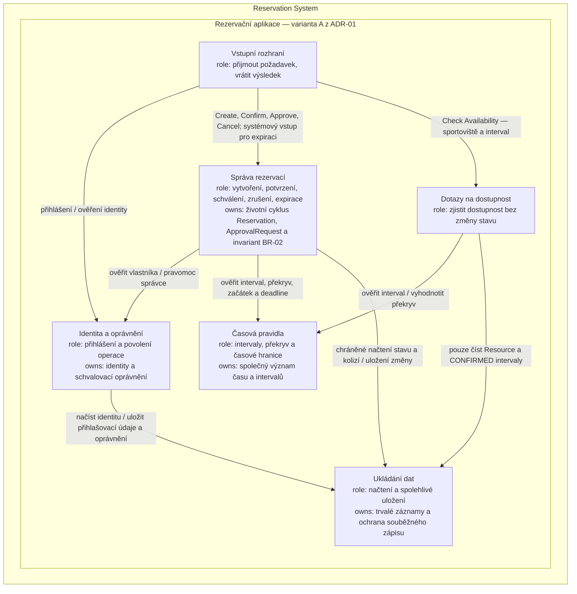

# G2 — TO-BE statická architektura

Návrh rozděluje [odpovědnosti](system-responsibilities.md) do šesti logických
částí. Podle [ADR-01](architecture-decision.md) jsou všechny součástí jedné
rezervační aplikace; nevzniká samostatná rezervační služba.

Šipky označují povolená volání; výsledek se vrací volajícímu.
Externí systémy nyní nepoužíváme. Lidské aktéry zachycuje
[kontext G1](system-context.md).

## Hlavní vlastník každé odpovědnosti

| Odpovědnost | Jediný hlavní vlastník |
| --- | --- |
| ODP-01 — přijetí požadavku a odpověď | Vstupní rozhraní |
| ODP-02 — oprávnění k operaci | Identita a oprávnění |
| ODP-03 — časová pravidla | Časová pravidla |
| ODP-04 — životní cyklus rezervace | Správa rezervací |
| ODP-05 — rozhodnutí o alokaci a exkluzivita | Správa rezervací |
| ODP-06 — informace o dostupnosti | Dotazy na dostupnost |
| ODP-07 — čekající schvalování | Správa rezervací |
| ODP-08 — trvalé uložení a obnova | Ukládání dat |

## Důležité hranice

- **Správa rezervací rozhoduje.** Confirm i Approve používají stejnou
  kontrolu kolize a přechod na CONFIRMED. Cancel i expirace mění tentýž
  životní cyklus; nikdo jiný rezervaci přímo nepřepisuje.
- **Ukládání dat zajišťuje ochranu rozhodnutí.** Správa rezervací načte
  aktuální stav, vyhodnotí pravidla a uloží změnu v jedné chráněné operaci.
  Jiný požadavek nesmí mezi kontrolou a uložením potvrdit kolidující interval.
  Business pravidla vlastní Správa rezervací, technické uložení Ukládání dat.
  Každý požadavek má vlastní kontext ukládání; ochrana proti kolizím je
  společná i mezi procesy. Čas pro rozhodnutí se odečte až po získání ochrany.
- **Dostupnost je pouze dotaz.** Výsledek AVAILABLE není souhlas s pozdějším
  potvrzením. Dotaz sdílí časová pravidla, ale nic nezapisuje; Správa rezervací
  při potvrzení kontroluje aktuální kolize znovu.
- **Vstupy pravidla neobcházejí.** Ověřují přihlášení; Správa rezervací
  navíc žádá o kontrolu vlastnictví nebo schvalovacího oprávnění. Expirace
  používá důvěryhodný systémový vstup a stejné přechody jako ostatní operace.

Plánované spouštění expirace pouze vyvolá tento systémový vstup; neurčuje
pravidla vypršení. Správa katalogu Sport/Resource není v tomto rezervačním
slice rozkreslená. Logické rozdělení je nyní realizované v kódu; mapování tříd na soubory
je v H2. Automatické spouštění expirace zůstává provozním úkolem.
