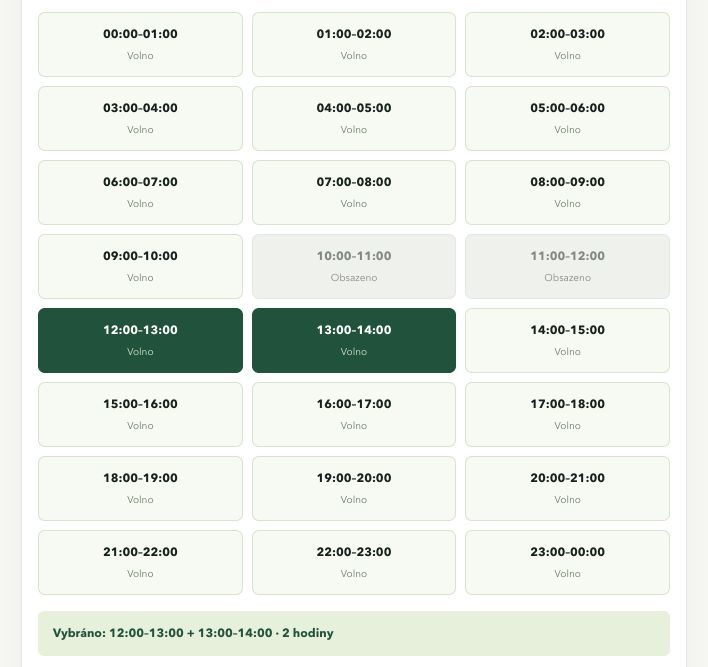

# Ověření hodinového rozvrhu — REQ-12

**Zdroj změny:** Požadavek uživatele 7. 11. 2026. [REQ-12](../requirements/hourly-schedule.md) doplňuje výběr času k REQ-01, bez změny pěti stavů rezervace nebo limitu BR-03.

## Realizace a prokliky

[Návrh a sekvence](../design/hourly-schedule.md) · [Konkrétní symboly, UI soubory a testy](coverage.md#req-12)

Rozvrh používá 1 nebo 2 navazující hodinové bloky, místní den Europe/Prague a aktuální potvrzené intervaly. Ruční zadání zůstává dostupné. Potvrzené kolize blok znepřístupní i při částečném překryvu. Oba způsoby vstupu končí ve stejné transakčně chráněné službě.

## Automatické scénáře

| Scénář | Oracle / očekávaný výsledek |
| --- | --- |
| Jeden / dva sousední bloky | Jedna rezervace přesně 60 / 120 minut; zachování dne a sportoviště po odeslání |
| Tři bloky, mezera, duplicita, neznámý klíč nebo žádný blok | Chyba formuláře bez vytvoření rezervace |
| Částečná potvrzená kolize | Celý dotčený blok nedostupný; sousední intervaly volné |
| Čekající žádost, zrušený záznam nebo jiný Resource | Samy o sobě blok daného sportoviště neobsadí |
| Sportoviště se schvalováním | Vznik PENDING_APPROVAL |
| Zastaralý dostupný blok a mezitím potvrzená kolize | Služba odmítne vytvoření, vznikne pouze původní potvrzená rezervace |
| Podstrčené datum a čas v blokovém POST | Interval určuje pouze platný výběr serverových bloků |
| Minulý čas, vzdálený den, neznámé sportoviště | Nezvolitelné bloky nebo odmítnutí vstupu |
| Ruční zadání 3 hodin | Odmítnutí serverem i bez JS |
| Pouhá kontrola dostupnosti | Žádný zápis rezervace |
| Nepřihlášený POST | Přesměrování na přihlášení, žádná rezervace |
| Změna letního času | 23 / 25 reálných hodinových bloků; délka dvou hodin vyhodnocená v UTC |

Starší test soukromí portálu nyní identifikuje konkrétní sekci správce podle `staff-title`; obecná vysvětlivka „Čekající žádosti termín neblokují“ není zpřístupněním této sekce.

## Ověření v prohlížeči

Na samostatném lokálním serveru s dočasnou testovací databází byl ověřen výběr 12:00–13:00 + 13:00–14:00, zamítnutí přidání třetího bloku, přepnutí na ruční zadání a úspěšné vytvoření jedné potvrzené rezervace 12:00–14:00. Obsazené bloky 10:00–12:00 nebyly volitelné. Kontrola používala výchozí viewport prohlížeče o šířce 708 px; rozvrh se zobrazil ve třech sloupcích bez vodorovného přetékání. Aplikační databáze nebyla pro náhled použita.



## Reprodukovatelné ověření

```sh
PYTHONDONTWRITEBYTECODE=1 SPORT_BOOKING_TEST_DB=/tmp/sport-booking-hourly-schedule-20261107.sqlite3 .venv/bin/python sport_booking/manage.py test reservations --noinput --verbosity 2
PYTHONDONTWRITEBYTECODE=1 .venv/bin/python sport_booking/manage.py makemigrations --check --dry-run
python3 scripts/update_docs.py --check
```

**Výsledek:** 16 nových automatických testů rozvrhu; celkem 83 testů, všechny prošly a žádný nebyl přeskočený. [Úplný výstup](evidence/hourly-schedule.log) obsahuje konkrétní spuštěné testy aktuálního pracovního stromu. Testy zahrnují i stávající souběh, rollback a migraci. Změna nevyžaduje novou migraci.

Vztah k dostupným hodnoticím kritériím R1–R5, vlastnictví a dohledatelnosti podle C03/C05/C06 popisuje [evidence portálu](portal-requirements.md#vazba-na-dostupná-zadání). REQ-12 má vlastní kontrakt, vlastníky a pozitivní, negativní i časové hraniční příklady. Tato projektová změna vychází z výslovného požadavku uživatele; historické baseline a předchozí výsledky ověření zůstávají zachované.
