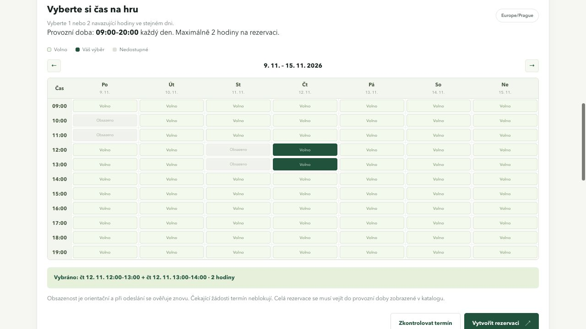

# Týdenní rozvrh a provozní doba — REQ-12 a REQ-13

**Požadavek uživatele:** 7. 11. 2026 nahradit velké denní bloky kompaktní týdenní tabulkou a vynucovat provozní dobu sportovišť nastavovanou správcem.

[REQ-12 — týdenní výběr](../requirements/hourly-schedule.md) · [REQ-13 — provozní doba](../requirements/operating-hours.md) · [BR-09](../requirements/business-rules.md#br-09) · [Návrh a vlastníci](../design/hourly-schedule.md)

## Realizace

Dny pondělí až neděle jsou ve sloupcích, hodiny v řádcích. Buňky mají výšku přibližně 27 px místo původních velkých dlaždic. Týdny lze přepínat v povoleném horizontu, výběr je nejvýše dvě navazující hodiny jednoho dne. Časové klíče obsahují datum; vytvořená rezervace proto odpovídá skutečně vybranému dni. Na menším displeji se posouvá pouze oblast tabulky a zůstávají popsané řádky a sloupce.

Provozní dobu lze změnit přímo v portálu stejnou rolí správce, která schvaluje žádosti, nebo v administraci. Každé sportoviště má jeden interval od–do, platný každý den. Otevírací doba již není informativní: vytvoření, dostupnost i pozdější schválení používají aktuální dobu podle BR-09. Celý interval musí být uvnitř, včetně ručního vstupu a API. Již potvrzené rezervace se při úpravě konfigurace automaticky neruší. Role správce je stejně jako dosud společná pro všechna sportoviště.

Využívají se existující pole `Resource.opens_at` / `closes_at`, bez nové migrace. Datový adaptér načítá oba časy v Resource DTO. ResourceService mění konfiguraci atomicky se stejnou ochranou jako rezervační operace; pravidla času vlastní TimeRules. Neplatné časy odmítne formulář, služba i modelová validace administrace.

## Scénáře a očekávané výsledky

| Scénář | Očekávaný výsledek |
| --- | --- |
| Celá rezervace přesně od otevření / do zavření | Povolena při splnění ostatních podmínek |
| Část rezervace před otevřením nebo po zavření | Odmítnutí bez vytvoření, API 409 |
| Availability mimo dobu | UNAVAILABLE |
| Ruční webový čas mimo dobu | Odmítnutí bez zápisu |
| Nekulatá doba 08:30–20:30 | Celé bloky 08–09 a 20–21 se nenabízejí; ruční 08:30–09:30 povolen |
| Dva bloky různých dnů | Odmítnutí; nejde o jednu dvouhodinovou rezervaci |
| Výběr pozdějšího dne v tabulce | Uložení přesného data vybraného bloku |
| Letní čas | Chybějící hodina má prázdnou buňku, opakovaná samostatný řádek; blok stále trvá 60 minut |
| Změna doby po podání žádosti | Approve znovu načte konfiguraci a odmítne interval mimo novou dobu |
| Neplatná konfigurace, zákazník, host, GET nebo chybějící CSRF | Žádná neoprávněná změna doby |
| Chyba dokončení transakce změny doby | Původní konfigurace zachovaná |

[Konkrétní testy a symboly rozvrhu](coverage.md#req-12) · [Konkrétní testy a symboly provozní doby](coverage.md#req-13)

Stávající testy rezervačních operací nyní vytvářejí platné příklady uvnitř provozní doby; jejich čas se neopírá o náhodnou aktuální hodinu spuštění. Dvouhodinový limit, stavy, ochrana před souběhem a rollback zůstávají ověřené.

## Kontrola UI

V prohlížeči nad oddělenou dočasnou databází bylo ověřeno sedm sloupců, přepnutí týdne, výběr dvou sousedních hodin středy a odmítnutí spojení dvou různých dnů. Odeslání vytvořilo správnou rezervaci na středu 12:00–14:00. Správce následně změnil dobu z 08:00–22:00 na 09:00–20:00; tabulka ihned nabídla jen řádky 09:00 až 19:00 a katalog i hlavička zobrazily nové nastavení. Aplikační databáze nebyla pro náhled použita.



## Ověření aktuálního pracovního stromu

```sh
PYTHONDONTWRITEBYTECODE=1 SPORT_BOOKING_TEST_DB=/tmp/sport-booking-weekly-hours-20261107.sqlite3 .venv/bin/python sport_booking/manage.py test reservations --noinput --verbosity 2
PYTHONDONTWRITEBYTECODE=1 .venv/bin/python sport_booking/manage.py makemigrations --check --dry-run
python3 scripts/update_docs.py --check
```

**Výsledek: 101 testů, všechny prošly, žádný přeskočený.** Z toho 17 nových testů provozní doby a jeden nový test týdenní tabulky při změně času. [Úplný log](evidence/weekly-operating-hours.log) obsahuje konkrétní provedené testy včetně souběhu, rollbacku a migrace starých DRAFT. Kontrola schématu nevyžaduje novou migraci.

Starší denní rozvrh a informativní význam otevírací doby zůstávají pouze v historických baseline a dřívějších záznamech ověření. Vazbu kontraktů a pozitivních / negativních příkladů na dostupná hodnoticí kritéria popisuje [evidence portálu](portal-requirements.md#vazba-na-dostupná-zadání).
